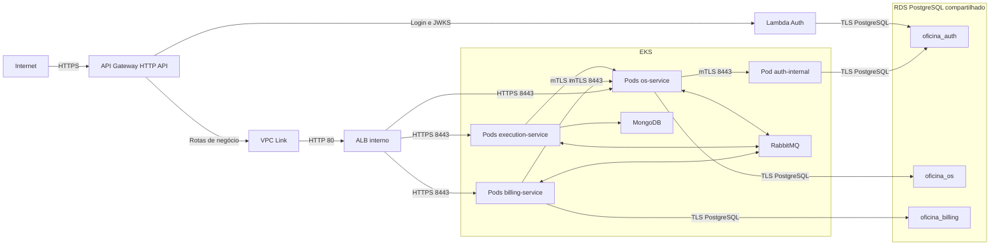
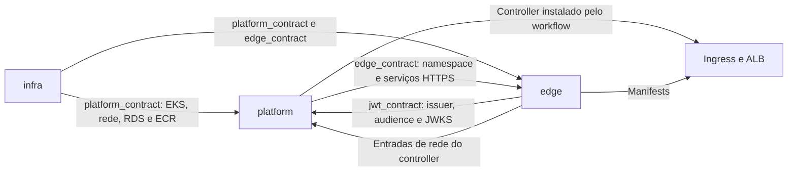

# Oficina mecânica — plataforma efêmera da Fase 4

Plataforma efêmera da Fase 4 do Tech Challenge FIAP, organizada em quatro microsserviços com repositórios próprios: Auth, OS, Execution e Billing. O [Deploy](.github/workflows/deploy.yml) opera `demo-a`, em `us-east-1`.

Este documento descreve o código e as verificações declaradas, sem presumir um ambiente em execução. As fontes são os workflows indicados, `phase4/stacks`, `phase4/modules`, o [catálogo](phase4/environments/catalog.json) e `scripts/platform-secrets`. A única consulta a `images.yml` é a confirmação de seu cabeçalho, solicitada ao final.

| Repositório | Papel identificado |
| --- | --- |
| [infra](https://github.com/AuroNet0/tech-challenge-oficina-k8s-infra) | Provisionamento, publicação e remoção da plataforma; identificação da automação em [platform_secrets.py](scripts/platform-secrets/platform_secrets.py). |
| [auth](https://github.com/AuroNet0/tech-challenge-oficina-auth) | Login/JWKS por Lambda; identidade interna e migração do banco Auth no cluster. |
| [os-service](https://github.com/AuroNet0/tech-challenge-oficina-os-service) | Clientes, veículos, filiais e ordens de serviço, incluindo consulta de Saga. |
| [execution-service](https://github.com/AuroNet0/tech-challenge-oficina-execution-service) | Diagnósticos, reparos, fila e histórico de execuções. |
| [billing-service](https://github.com/AuroNet0/tech-challenge-oficina-billing-service) | Orçamentos, pagamentos, notificações e configuração Mercado Pago. |

Os quatro repositórios de serviços constam no [Deploy](.github/workflows/deploy.yml). Os papéis públicos derivam da [allowlist](phase4/stacks/edge/routes.tf); a identidade interna consta em [auth-internal.tf](phase4/stacks/platform/auth-internal.tf).

## 1. Arquitetura

O [Deploy](.github/workflows/deploy.yml) usa `alb_tls: null`. O [Ingress](phase4/stacks/edge/ingress.tf) declara ALB interno com listener HTTP 80, destinos por IP, backend HTTPS 8443 e health check HTTPS em `/actuator/health/readiness`. As configurações dos pods, bancos e chamadas internas estão em [applications.tf](phase4/stacks/platform/applications.tf), [auth-internal.tf](phase4/stacks/platform/auth-internal.tf) e [mtls_contract](phase4/stacks/platform/outputs.tf).

A exposição pública segue uma allowlist de métodos e caminhos em [routes.tf](phase4/stacks/edge/routes.tf). O Ingress deriva dessa lista e restringe também o método HTTP. Não há rota pública genérica para `/internal/*`. O webhook Mercado Pago é opcional no stack e permanece desabilitado no Deploy.

As rotas do API Gateway usam `authorization_type = "NONE"`. A validação do JWT fica nos próprios serviços, configurados com issuer, audience e JWKS por [applications.tf](phase4/stacks/platform/applications.tf), a partir do [contrato JWT do edge](phase4/stacks/edge/outputs.tf). O job E2E verifica os resultados de autenticação e autorização descritos adiante.

## 2. Os três stacks Terraform

| Stack | Recursos e responsabilidades |
| --- | --- |
| [infra](phase4/stacks/infra/main.tf) | VPC, sub-redes públicas/privadas em duas AZs, Internet Gateway, rotas, security groups, IAM, EKS, RDS e quatro repositórios ECR. |
| [platform](phase4/stacks/platform/main.tf) | Addons EKS, identidades e contratos; renderização de manifests de namespace, RBAC, rede, dados, bootstrap, migração Auth e aplicações. O workflow aplica os manifests com `kubectl` e instala o ALB Controller com Helm. |
| [edge](phase4/stacks/edge/main.tf) | API Gateway, VPC Link, rede, security groups, endpoint privado do Secrets Manager, Lambda Auth e IAM; contratos JWT e manifests de Ingress que levam o controller a criar o ALB interno. |

- **EKS:** Kubernetes `1.35`; o Deploy configura dois nodes `m7i-flex.large` sob demanda, em sub-rede pública da primeira AZ. O cluster tem endpoint privado e, no workflow, acesso público com CIDR `0.0.0.0/0`. Fontes: [eks.tf](phase4/stacks/infra/eks.tf), [variables.tf](phase4/stacks/infra/variables.tf) e [Deploy](.github/workflows/deploy.yml).
- **VPC:** sub-redes públicas e privadas em duas AZs; as privadas têm tabela de rotas isolada. Fontes: [network.tf da infra](phase4/stacks/infra/network.tf) e [rede do edge](phase4/stacks/edge/network.tf).
- **RDS:** PostgreSQL `17.10` declarado, classe padrão `db.t4g.micro`, 20 GiB gp3, criptografia e SSL obrigatório. A instância é privada, sem Multi-AZ, com atualização automática de versão minor habilitada. Fontes: [variables.tf](phase4/stacks/infra/variables.tf) e [rds.tf](phase4/stacks/infra/rds.tf).
- **Bancos:** Auth, OS e Billing têm bancos e usuários separados na mesma instância RDS: `oficina_auth`, `oficina_os` e `oficina_billing`. A infra declara os alvos e o [bootstrap SQL](phase4/stacks/platform/scripts/bootstrap.sql) cria bancos/roles. Execution usa `oficina_execution` no MongoDB. Fontes: [infra/main.tf](phase4/stacks/infra/main.tf), [applications.tf](phase4/stacks/platform/applications.tf) e [bootstrap MongoDB](phase4/stacks/platform/scripts/mongo-init.js).
- **Dados no cluster:** MongoDB e RabbitMQ são StatefulSets com volumes persistentes; o PostgreSQL dos serviços fica no RDS. Fonte: [kubernetes.tf](phase4/stacks/platform/kubernetes.tf).
- **ECR:** quatro repositórios, `auth`, `os`, `execution` e `billing`, com tags imutáveis e varredura no push. O Deploy usa SHA como tag e consolida referências por digest em `images.json`. Fontes: [ecr.tf](phase4/stacks/infra/ecr.tf) e [Deploy](.github/workflows/deploy.yml).
- **Auth público:** Lambda Java 21 em VPC, com JAR versionado no S3 e layer de bootstrap; login e JWKS passam pelo API Gateway. Fontes: [lambda.tf](phase4/stacks/edge/lambda.tf) e [routes.tf](phase4/stacks/edge/routes.tf).

### Contratos

Entradas e saídas: [infra/outputs.tf](phase4/stacks/infra/outputs.tf), [platform/outputs.tf](phase4/stacks/platform/outputs.tf), [edge/outputs.tf](phase4/stacks/edge/outputs.tf) e [controller-contract.tf](phase4/stacks/edge/controller-contract.tf). O Deploy resolve as dependências em aplicações sucessivas dos stacks. Cada stack tem uma chave de state própria no [catálogo](phase4/environments/catalog.json).

## 3. Justificativas do projeto

As justificativas resumem a organização declarada. A motivação histórica das decisões não está documentada nas fontes permitidas.

| Decisão | Justificativa e evidência disponível |
| --- | --- |
| Saga no contexto de OS | Há consulta de Saga em OS e permissões RabbitMQ para `os.saga.events` e `execution.diagnostic.start`. Orquestração pelo os-service, etapas e compensações: **não identificado** nas fontes permitidas. Referência solicitada: [README do os-service, seção Saga](https://github.com/AuroNet0/tech-challenge-oficina-os-service/blob/main/README.md#saga); conteúdo e âncora não confirmados. Fontes locais: [rotas](phase4/stacks/edge/routes.tf) e [permissões](scripts/platform-secrets/platform_secrets.py). |
| Quatro serviços | A separação de Auth, OS, Execution e Billing corresponde aos quatro repositórios, grupos de rotas e bancos próprios declarados. O Deploy constrói cada serviço em uma matriz; pipeline próprio em cada repositório: **não identificado**. Fontes: [Deploy](.github/workflows/deploy.yml), [rotas](phase4/stacks/edge/routes.tf) e [dados](phase4/stacks/platform/applications.tf). |
| PostgreSQL e MongoDB | PostgreSQL atende Auth, OS e Billing; MongoDB atende Execution. A associação está em [applications.tf](phase4/stacks/platform/applications.tf) e [auth-internal.tf](phase4/stacks/platform/auth-internal.tf). A justificativa específica baseada em dados relacionais/transacionais ou modelo documental: **não identificado**. |
| RabbitMQ | Um broker com credenciais e permissões por serviço sustenta comandos/eventos; as permissões incluem comando de diagnóstico e eventos de Saga. Catálogo completo de mensagens: **não identificado**. Fontes: [applications.tf](phase4/stacks/platform/applications.tf) e [platform_secrets.py](scripts/platform-secrets/platform_secrets.py). |
| AWS EKS/API Gateway/Lambda | A divisão declarada concentra pods no EKS, entrada pública no API Gateway e login/JWKS na Lambda, com integração privada para o negócio. Fontes: [EKS](phase4/stacks/infra/eks.tf), [integrações](phase4/stacks/edge/routes.tf) e [Lambda](phase4/stacks/edge/lambda.tf). |

## 4. Como operar

### Pré-requisitos

O [Deploy](.github/workflows/deploy.yml) é manual (`workflow_dispatch`) e valida:

- Variável de repositório `AWS_ROLE_ARN` com ARN de role IAM válido da conta do catálogo. A identidade STS precisa corresponder à role assumida.
- Autenticação AWS por OIDC, com `id-token: write` e `aws-actions/configure-aws-credentials`. A role deve aceitar a federação OIDC para essa execução. Trust policy concreta, principals e condições de subject/audience: **não identificado**; a role de automação não é declarada nas fontes permitidas.
- Segredos de entrada no Secrets Manager, recebidos pelos inputs. O Resolve valida formato dos ARNs, conta/região e existência por `describe-secret`, sem ler valores nessa etapa.
- Segredo `/oficina/phase4/demo-a/auth-signing` previamente existente. `ResourceNotFoundException` interrompe o Resolve; outros erros nessa consulta geram aviso. O formato de seu conteúdo é **não identificado** nas fontes permitidas.
- Buckets `tc-oficina-p4-demo-a-artifacts` e `tech-challenge-oficina-terraform-state-b1cfa326` existentes e acessíveis na conta esperada. Os nomes constam no workflow; o bucket de state consta também no [catálogo](phase4/environments/catalog.json).

| Entrada sensível | Contrato, sem valores |
| --- | --- |
| `mercado_pago_secret_arn` | JSON com `access-token` e `webhook-secret`, não vazios, de 16 a 512 caracteres e sem espaços em branco; token com prefixo `TEST-` ou `APP_USR-`. A entrega rejeita fontes canônicas internas e exclusão pendente. Fontes: [deliver.py](scripts/platform-secrets/deliver.py) e [validações](scripts/platform-secrets/platform_secrets.py). |
| `smoke_secret_arn` | JSON com `email` em minúsculas no domínio `example.invalid` e `password` de 12 a 1024 caracteres, validado no E2E do [Deploy](.github/workflows/deploy.yml). |
| `auth-signing` | Fonte da chave de assinatura consumida pela Lambda via Secrets Manager, conforme [lambda.tf](phase4/stacks/edge/lambda.tf). |

O [Destroy](.github/workflows/destroy.yml) chama os segredos de entrada de `MERCADO_PAGO_CREDENTIAL` e `E2E_SMOKE_USER` no resumo de preservação. O Deploy recebe seus ARNs e não exige esses nomes para os dois segredos externos.

### Deploy

Execute [Deploy](.github/workflows/deploy.yml) no GitHub Actions com:

| Input | Uso |
| --- | --- |
| `services_ref` | Branch, tag ou commit resolvido nos quatro repositórios públicos; padrão `main`. |
| `mercado_pago_secret_arn` | Referência obrigatória ao segredo externo Mercado Pago. |
| `smoke_secret_arn` | Referência obrigatória às credenciais do smoke. |

Ordem real dos jobs:

1. **Resolve:** valida role, identidade, catálogo, referências dos segredos, buckets e SHAs dos serviços.
2. **Infra e Auth artifact, em paralelo:** provisiona infra; constrói JAR Auth e layer, publica/verifica artefatos e gera `auth_release.json`.
3. **Imagens e consolidação:** após Infra, constrói ou reutiliza as imagens dos quatro serviços, resolve digests das dependências e publica `images.json`.
4. **Platform dados:** configura addons/contratos, aplica fundação/rede, entrega segredos, inicia MongoDB/RabbitMQ, executa bootstrap PostgreSQL e migração Auth e limpa os segredos temporários dessas tarefas.
5. **Edge Auth:** depende de Platform dados e Auth artifact; publica Lambda/login/JWKS e verifica JWKS.
6. **Platform apps:** recebe contratos JWT e aplica as aplicações, aguardando os Deployments.
7. **Platform controller:** prepara a identidade e instala/verifica o AWS Load Balancer Controller.
8. **Edge ALB:** aplica Ingress, aguarda ALB, descobre listener HTTP e aguarda targets saudáveis.
9. **Edge rotas de negócio:** publica integrações de negócio, verifica targets e executa smoke de negócio.
10. **E2E:** semeia um usuário ATENDENTE e verifica login/autorização.
11. **Resumo:** executa com `always()` e reúne os resultados.

Tempo aproximado de **45–60 minutos após a infra: não identificado** nas fontes permitidas. Timeouts de jobs são limites, não medições de duração.

Deploy e Destroy usam o grupo de concorrência `phase4-demo-a-mutation`, com `cancel-in-progress: false`, conforme os dois workflows.

### Destroy

Execute [Destroy](.github/workflows/destroy.yml) com:

| Input | Validação |
| --- | --- |
| `confirm` | Texto exato `destroy demo-a`. |
| `images_run_id` | Run concluído deste repositório com artefato `images.json`: de `images.yml` com conclusão `success`, ou de `deploy.yml` com qualquer conclusão. |

As quatro fases são:

1. **Preparação:** valida confirmação, run, identidade e catálogo; baixa `images.json`, inicializa states, recupera contratos e inventaria cluster, ALB, target groups, VPC e volumes.
2. **Limpeza do cluster:** remove Ingresses/configuração edge, aguarda ALB/target groups/bindings, remove workloads/PVCs, aguarda volumes EBS e remove releases Helm/namespaces. É pulada quando o cluster está ausente.
3. **Edge, platform e segredos:** planeja e destrói edge antes de platform; executa `destroy-secrets` apenas para segredos canônicos efêmeros com ownership/tags validados.
4. **Infra e auditoria:** planeja e destrói infra; consulta a AWS independentemente dos states para verificar resíduos de EKS, RDS, ALB, target groups, EBS, ENIs, security groups, VPC, ECR, Lambda, API Gateway e segredos do ambiente, exceto `auth-signing`. Também confirma os dois buckets preservados; resíduos ou falhas nessa confirmação reprovam a auditoria.

A auditoria é independente dos states, mas é um passo posterior no mesmo job, sem `if: always()`; uma falha anterior pode impedir sua execução. Há diagnóstico condicionado a falha ao final.

São preservados o bucket de artefatos, o bucket de state, `auth-signing` e os dois segredos externos de entrada. Fontes: [Destroy](.github/workflows/destroy.yml) e [destroy_secrets](scripts/platform-secrets/deliver.py).

**Custo aproximado de US$ 9/dia com o ambiente de pé: não identificado** nas fontes permitidas. Execute Destroy após o uso; os recursos têm ciclo de vida efêmero declarado no [módulo de ambiente](phase4/modules/environment/main.tf).

## 5. Smoke test — job E2E do Deploy

O job `e2e` do [Deploy](.github/workflows/deploy.yml) lê as credenciais de smoke, semeia um usuário ATENDENTE no Auth por Job `psql` e verifica:

| Requisição | Credencial | Resultado esperado |
| --- | --- | --- |
| `POST /api/v1/auth/login` | Credenciais de smoke | `200` e `accessToken` não vazio. |
| `GET /api/v1/clientes` | Token do ATENDENTE | `200` no os-service. |
| `GET /api/v1/diagnosticos` | Token do ATENDENTE | `403` no execution-service. |
| `GET /api/v1/notificacoes` | Token do ATENDENTE | `403` no billing-service. |
| `GET /api/v1/clientes` | Token inválido | `401`. |

O job registra status esperados/obtidos no resumo, mascara senha/token e limpa o Secret SQL temporário com `always()`. Esses testes verificam login e restrições de acesso; não demonstram uma execução completa da Saga.

## Fluxo completo no Postman

Arquivo disponível: [coleção Oficina — Fluxo completo da OS (demo)](docs/postman/full-cycle-collection.json).

A coleção realiza os logins dos quatro perfis: Atendente, Mecânico, Cliente e Gerente. O fluxo principal cria filial, cliente e veículo e abre a OS pelo os-service; executa o diagnóstico pelo Execution, aprova o orçamento no Billing, realiza o reparo e o checkout do pagamento e consulta o histórico da OS e o estado final da Saga. A pasta `Compensação (orçamento rejeitado)` rejeita o orçamento e verifica Saga `COMPENSATED` e OS `CANCELADA`.

1. Importe a coleção disponível. A importação dos dois arquivos depende da disponibilização do arquivo de ambiente; enquanto ele estiver ausente, crie o ambiente manualmente.
2. Selecione o ambiente `Oficina - AWS` e preencha `baseUrl` com a URL do API Gateway exibida pelo Deploy e as credenciais dos quatro perfis: `emailAtendente`/`senhaAtendente`, `emailMecanico`/`senhaMecanico`, `emailCliente`/`senhaCliente` e `emailGerente`/`senhaGerente`.
3. Execute a coleção no Collection Runner, na ordem apresentada, começando pelos logins do fluxo principal.
4. Observe as consultas que aguardam o processamento assíncrono via RabbitMQ: diagnóstico, orçamento, reparo e pagamento repetem a consulta até oito vezes adicionais quando o recurso ainda não foi encontrado.

As coleções por serviço, em `docs/postman` de cada repositório de serviço, cobrem cada API individualmente; a coleção disponível neste repositório usa variáveis, sem valores de credenciais ou tokens versionados.

## 6. Limitações conhecidas

- **Role de automação ampla no cluster:** o Deploy passa `AWS_ROLE_ARN` como administrador do EKS, e [eks.tf](phase4/stacks/infra/eks.tf) associa `AmazonEKSClusterAdminPolicy` no escopo do cluster. O conjunto completo das permissões IAM dessa role é **não identificado**.
- **Role compartilhada no Deploy:** os jobs de imagens, infra, platform e edge usam a mesma variável. Reutilização por CD próprio nos repositórios dos serviços: **não identificado** nas fontes permitidas.
- **Ambiente efêmero:** [ecr.tf](phase4/stacks/infra/ecr.tf) usa `force_delete = true`; o Destroy elimina repositórios ECR e imagens. O próximo Deploy recria os repositórios e reconstrói imagens quando as tags estão ausentes. O RDS é destruído sem snapshot final e com remoção de backups automatizados, conforme [rds.tf](phase4/stacks/infra/rds.tf).

## 7. Estrutura do repositório

| Pasta ou arquivo | Conteúdo verificado |
| --- | --- |
| `docs/postman` | Coleção Postman do fluxo completo e ambiente |
| [.github/workflows/deploy.yml](.github/workflows/deploy.yml) | Provisionamento, build, publicação e E2E. |
| [.github/workflows/destroy.yml](.github/workflows/destroy.yml) | Remoção em quatro fases e auditoria residual. |
| [.github/workflows/images.yml](.github/workflows/images.yml) | Cabeçalho `Images (temporary)`; seu run bem-sucedido é aceito pelo Destroy como origem de `images.json`. |
| [phase4/stacks/infra](phase4/stacks/infra/main.tf) | Infraestrutura AWS e contratos. |
| [phase4/stacks/platform](phase4/stacks/platform/main.tf) | Suporte EKS e contratos/manifests Kubernetes. |
| [phase4/stacks/edge](phase4/stacks/edge/main.tf) | Entrada pública, Auth Lambda, integrações privadas e Ingress. |
| [phase4/modules/environment](phase4/modules/environment/main.tf) | Identidade do ambiente, catálogo, tags e validações. |
| [phase4/modules/alb-controller-policy](phase4/modules/alb-controller-policy/main.tf) | Política IAM do ALB Controller. |
| [phase4/environments/catalog.json](phase4/environments/catalog.json) | Conta, região, backend e chaves dos states. |
| [scripts/platform-secrets](scripts/platform-secrets/deliver.py) | Entrega, validação e remoção de segredos efêmeros. |

Cabeçalhos atuais: `Deploy`, `Images (temporary)` e `Destroy (temporary)`.

