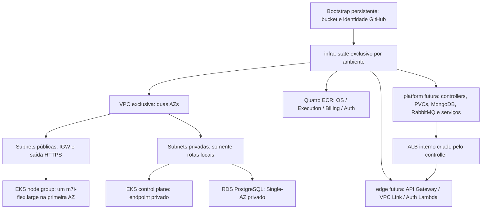

# Etapa 9.2.2-B — infraestrutura AWS efêmera

Data: 2026-10-31. Status: declarações para revisão e posterior plan autorizado.
Nenhuma infraestrutura foi criada, descoberta ou validada na AWS. Não houve
apply, destroy, deploy, SQL, migração/import de state, commit ou push.

## 1. Base e limites da inspeção

Branch inicial `homolog`, HEAD `6d55d2bc06ecf84b16325a1b9c288138a7602e1c`,
árvore limpa. Foram inspecionados `phase4/`, catálogo, módulo environment,
scripts, workflow e declarações legadas de rede/EKS/ECR/IAM. As declarações
RDS do checkout vizinho database-infra e a Lambda Auth legada foram somente
lidas. Declaração antiga não constitui evidência de recurso implantado.

Reaproveitados: módulo local environment, catálogo, guardas e resolvedor de
backend/SHA, provider AWS fixado em 5.100.0 e estratégia de duas AZs com nodes
públicos da Fase 3. Nenhum novo módulo externo foi introduzido. A root legada,
seus recursos, roles GitHub/OIDC, backends e states não foram editados, adotados
ou referenciados por data sources. Nada foi alterado nos microserviços ou no
repositório database-infra.

O único workflow local continua `ci-cd.yml`, somente `workflow_dispatch`, sem
`push`, `workflow_call` ou gatilho indireto local. Seu apply é LEGADO e não deve
ser executado para esta fase. Nenhum workflow operacional foi criado.

## 2. Arquitetura e recursos

Bootstrap é pré-requisito de identidade/backend; não pertence ao destroy de infra.
A VPC tem DNS habilitado, duas subnets públicas, duas privadas, IGW, tabela
pública com saída internet e tabela privada explicitamente sem rotas externas.
EKS usa ambas as privadas para ENIs do control plane; nodes ficam somente na
primeira subnet pública. RDS usa subnet group com ambas as privadas e uma
instância na primeira AZ. Não há NAT, endpoints, ALB, API Gateway, Lambda,
MongoDB, RabbitMQ ou objetos Kubernetes declarados nesta etapa.

| Arquivo | Declarações novas |
| --- | --- |
| main.tf | `terraform_data.environment_guard`, anterior aos recursos AWS |
| network.tf | VPC, quatro subnets, IGW, duas route tables, rota internet, quatro associações |
| security.tf | SG de nodes, SG de RDS e regras explícitas de entrada/saída |
| iam.tf | roles EKS/nodes, três anexos de policies AWS e policy ECR restrita |
| eks.tf | log group, cluster, access entry/policy, launch template, managed node group |
| ecr.tf | quatro repositórios e quatro lifecycle policies |
| rds.tf | subnet group, parameter group e instância PostgreSQL |
| outputs.tf | `platform_contract` e `edge_contract` |

Todos pertencem somente ao ambiente selecionado. Default tags do provider
propagam Project, Owner, EnvironmentId, Phase=4, Lifecycle=ephemeral,
Shared=false, ManagedBy e GitRevision aos recursos que suportam tags. O launch
template aplica essas tags também a instâncias, volumes e interfaces EC2;
tags do node group sozinhas não seriam suficientes para esses recursos.

## 3. Rede, saída e exposição

| Alternativa | Saída real e limitações | Decisão |
| --- | --- | --- |
| Nodes públicos + IGW | IPv4 público por node; pods VPC CNI usam SNAT para sair. ECR/S3/STS/telemetria por HTTPS. Exige SG sem entrada pública e políticas Kubernetes | escolhida para demo |
| Nodes privados + NAT | resolve registries e serviços externos; NAT tem cobrança por hora/dados e pode precisar de IPv4/transferência entre AZs | não declarado |
| Nodes privados + endpoints | requer ECR API/DKR, S3, STS, EC2 e demais serviços efetivamente usados, como Logs, EKS Auth e Secrets Manager. Endpoints de interface têm custo por AZ/dados; New Relic e Mercado Pago continuam precisando de saída externa | alternativa futura, não tratada como solução completa |

As públicas têm `map_public_ip_on_launch=true`. Isso evita a topologia privada
sem saída e permite bootstrap/pull de imagens sem NAT. **Nodes terão IP público**:
é uma concessão explícita de superfície de rede e custo IPv4. Não há ingresso
de internet, SSH, remote access, portas públicas de aplicação ou descoberta
automática de ALB público pela tag `kubernetes.io/role/elb`. SG não protege
contra futuras configurações inseguras de LoadBalancer/hostNetwork; platform
deverá proibir essas exposições, usar ClusterIP, ALB interno e NetworkPolicies.

SG de nodes permite tráfego interno entre seus próprios membros, entrada do
SG do control plane em 443/9443/10250, saída HTTPS 443, DNS TCP/UDP 53 ao
resolver da VPC e PostgreSQL 5432 ao SG do RDS. HTTPS para internet é amplo em
destino, mas restrito em porta: não é um filtro de domínio ou prevenção de
exfiltração. O resolver AmazonProvidedDNS também possui exceções de filtragem
AWS; essas regras não substituem DNS Firewall ou NetworkPolicies.

O SG de RDS aceita somente 5432 a partir do SG de nodes, sem toda a VPC, sem
ingresso público e sem regras próprias de saída iniciada pelo banco. Respostas
das conexões são stateful. O SG padrão do control plane é criado pelo EKS e
possui regras gerenciadas pela AWS, incluindo saída ampla; não se promete que
essas regras tenham sido reduzidas por esta implementação.

As privadas não têm NAT nem rota internet. RDS não precisa de egress público.
VPC Link/ALB privados usam conectividade local. Uma futura Lambda Auth nessas
subnets **não conseguirá consultar Secrets Manager/JWKS externo/internet** sem
endpoints ou outra solução de saída explicitamente aprovada em edge.

## 4. EKS, administração e capacidade

Um cluster por ambiente, Kubernetes `1.35` explícito, AL2023 x86_64 no node
group e suporte `STANDARD` para evitar adesão silenciosa ao suporte estendido.
Segundo o [calendário EKS](https://docs.aws.amazon.com/eks/latest/userguide/kubernetes-versions.html),
1.35 está em suporte padrão nesta data, com fim previsto em 27/03/2027.
Confirmar novamente antes do provisionamento; `STANDARD` permite atualização
automática no fim desse prazo. AMI patch/release e addons bootstrap são
selecionados pelo EKS para a versão: não há pin de AMI/patch com garantia
bit a bit; platform deverá revisar/pinar versões de addons gerenciados.

Endpoint privado por padrão. `eks_public_access_cidrs=[]` mantém o público
desligado; lista não vazia habilita somente IPv4 /32 administrativos explícitos.
Não aceita 0.0.0.0/0. O runner futuro precisa estar na VPC/rede alcançável ou
possuir egress estável previamente aprovado nessa lista. Runners GitHub
hospedados comuns têm IPs variáveis: não abrir endpoint a todos para contornar.
Estar na VPC também exige autorização de SG: um runner privado dedicado precisa
de regra TCP 443 no SG do control plane a partir de seu próprio SG aprovado.
Essa integração com o runner ainda não foi criada. Uma alternativa revisável
é endpoint público limitado ao /32 estável do executor.

Autenticação `API`, sem privilégio implícito do criador. Input obrigatório
`eks_admin_role_arn` deve ser role existente da conta esperada; access entry e
AmazonEKSClusterAdminPolicy dão administração **deste cluster** para bootstrap.
Não concedem AdministratorAccess IAM. Deploy de aplicações deverá usar outra
role/RBAC de namespaces; a role administrativa precisa existir antes de infra.
Não há provider Kubernetes/Helm, token EKS ou dependência circular nesta root.

Node group ON_DEMAND com `node_count=1`, min=desired=max; não há autoscaler.
Tipo fixo proposto `m7i-flex.large`: [2 vCPU/8 GiB](https://aws.amazon.com/ec2/instance-types/general-purpose/);
confirmar oferta na AZ escolhida.
Node group fica na primeira AZ mesmo se aumentado, simplificando PVCs EBS
de demonstração; não constitui HA. Launch template exige IMDSv2/hop limit 1,
disco gp3 criptografado de 30 GiB e exclusão do volume no término; sem SSH.

Estimativa inicial **sem medição**, para orientar a etapa platform:

| Componente | Request CPU hipotético | Request RAM hipotético |
| --- | --- | --- |
| OS | 250m | 512 MiB |
| Execution | 250m | 512 MiB |
| Billing | 250m | 512 MiB |
| Auth interno Java | 150m | 256 MiB |
| MongoDB rs0 de membro único | 300m | 768 MiB |
| RabbitMQ | 150m | 384 MiB |
| Controllers/DNS/CNI/CSI | 300m | 512 MiB |
| New Relic | 300m | 768 MiB |
| Total antes de reservas do sistema | 1950m | 4224 MiB |

O total de CPU praticamente ocupa os 2 vCPU brutos, antes de kubelet/sistema;
requests, startup simultâneo, Argon2, MongoDB cache e picos podem impedir
agendamento ou causar throttling/OOM. Um node **não está comprovado como
suficiente** para toda a solução com observabilidade. Previsão prudente: dois
nodes do mesmo tipo, na mesma AZ, caso essa estimativa se confirme. O padrão
continua um conforme a proposta; só alterar `node_count` após revisão de
requests/limits e evidência de carga. Limites JVM, pool JDBC, caches e agentes
devem ser medidos antes de prometer a demonstração em um node. Rollout de um
node pode interromper workloads; volumes zonais não são HA.

## 5. ECR e contrato das imagens

Quatro repositórios `${prefix}-os`, `-execution`, `-billing`, `-auth`, sem
colisão entre ambientes; AES256, scan on push e tags imutáveis. O quarto é
reservado à imagem de Auth interno, condicionado à confirmação de seu artefato
real. Não se pressupõe que a Lambda pública usará essa imagem.

O CI futuro deve publicar tag SHA completo lowercase da revisão auditada e
implantar por digest, nunca `latest`. Repetição do mesmo SHA deve reutilizar
digest verificado ou falhar; não sobrescrever tags. Lifecycle mantém dez
imagens recentes; pode expirar imagem antiga ainda usada por rollout, portanto
revisar retenção antes de múltiplas demonstrações/rollbacks prolongados.

`force_delete=false`: destroy de repositório com imagem falha de propósito.
Antes de destruir infra, workflow futuro deverá conferir conta/região, catálogo,
prefixo, ARN **exato** de cada um dos quatro outputs ECR e tags de ownership.
Só então listar/batch-delete imagens nesses repositórios até esvaziar e conferir
novamente. Permitir `ecr:ListImages`/`ecr:BatchDeleteImage` exclusivamente nesses
ARNs; não descobrir destinos por prefixo global nem excluir ECR legado. Lifecycle
não garante limpeza imediata. Registrar digests/evidências antes de apagar.

## 6. RDS e bancos independentes

Instância PostgreSQL `17.10`, Single-AZ, `db.t4g.micro` inicial, gp3 20 GiB
criptografado, ajustável entre 20–100 GiB sem autoscaling. Classe ajustável
somente entre t4g micro/small/medium, após revisão. A memória de uma micro e
três pools pode ser insuficiente: medir conexões, Flyway e consumo antes do uso.
Parameter group postgres17 com `rds.force_ssl=1`. PostgreSQL 17.10 está no
[calendário RDS](https://docs.aws.amazon.com/AmazonRDS/latest/PostgreSQLReleaseNotes/postgresql-release-calendar.html);
confirmar engine/classe/região e minor vigente no plan autorizado. Minor upgrade
automático está habilitado; major upgrade e suporte estendido pagos, desabilitados.

Credencial master `infra_admin` gerada e gerenciada pelo RDS em Secrets Manager
(`manage_master_user_password=true`). Nenhuma senha é input, literal, output
ou valor lido por Terraform. Output fornece somente ARN do secret. A senha não
vai para state desta configuração, mas state/metadados continuam sensíveis e
exigem backend privado. Não conceder GetSecretValue aos nodes ou aplicações.

RDS cria apenas `oficina_bootstrap`; **os três bancos abaixo ainda não existem**:

| Serviço | Banco alvo | Role alvo | Contrato |
| --- | --- | --- | --- |
| Auth | oficina_auth | oficina_auth | AUTH_DB_HOST/PORT/NAME/USER/PASSWORD/SSLMODE |
| OS | oficina_os | oficina_os | DB_HOST/PORT/NAME/USERNAME/PASSWORD |
| Billing | oficina_billing | billing | DB_HOST/PORT/NAME/USERNAME/PASSWORD |

Na etapa posterior, um Job privado, autorizado e temporário deverá obter o
secret master por role própria, criar banco/role ausentes consultando pg_database
e pg_roles, revogar CONNECT/PUBLIC e privilégios padrão indevidos, definir owner
e grants somente do serviço, e armazenar uma senha independente por serviço em
Secrets Manager. PostgreSQL não tem CREATE DATABASE IF NOT EXISTS e não permite
CREATE DATABASE dentro de transação: a implementação deve tratar isso, usar
lock/retry e aspas/identificadores seguros. Reexecução não deve recriar bancos,
rotacionar senha sem coordenação ou conceder acesso cruzado.

Futuro Job de migração de cada serviço usa sua própria credencial/Flyway e
apenas o próprio banco; master nunca será credencial de aplicação. Se separar
role de migração e runtime depois, restringir DDL ao migrador. Não executar SQL
via provisioner Terraform ou provider PostgreSQL: isso exigiria rede/segredos
durante o plan e criaria acoplamento com o cluster.

Usar TLS `verify-full` com hostname RDS e CA oficial montada no container.
Para OS/Billing, sobrescrever `SPRING_DATASOURCE_URL` com JDBC incluindo
sslmode/sslrootcert: os YAML remotos inspecionados não colocam esses parâmetros
na URL. Para Auth, usar `AUTH_DB_SSLMODE=verify-full` e sua configuração de CA.
Forçar SSL no servidor não equivale a verificar identidade do servidor no cliente.

`skip_final_snapshot=true`, `deletion_protection=false`, retenção de backup 0 e
`delete_automated_backups=true`: exclusão causa perda definitiva dos dados.
Essas opções são fixas nesta stack exclusivamente efêmera, cujo guard exige
ready, Phase=4, Lifecycle=ephemeral e Shared=false antes de todos os recursos.
Não usar esta root para dados persistentes. Dumps/evidências sanitizadas devem
ser coletados antes de destruir; backups/snapshots manuais eventualmente criados
fora desta stack precisam de inventário próprio. Alterar tags/guard/backend ou
usar credenciais amplas pode contornar essas proteções: IAM e revisão continuam
necessários.

## 7. IAM e fronteiras de responsabilidade

| Identidade | Implementação nesta etapa | Responsabilidade futura |
| --- | --- | --- |
| GitHub automação persistente | preservada, sem edição de OIDC/trust/policy | role aprovada por ambiente, backend restrito e separação apply/destroy |
| EKS cluster | role exclusiva + AmazonEKSClusterPolicy | somente controle do cluster |
| Nodes | role exclusiva + WorkerNode/CNI e pull ECR restrito | sem permissão de secrets, push ou administração AWS |
| Administrador EKS | access entry para ARN obrigatório existente | bootstrap/RBAC; rede acessível, sem privilégio implícito do criador |
| Controllers e aplicações | não criados | roles por service account, Pod Identity preferencial; políticas por recurso |
| Deploy de workloads | não criado | ECR push dos quatro ARNs, DescribeCluster e RBAC necessário |
| Destroy | não criado | somente recursos/state/tags do ambiente, com proteção persistente |

A policy ECR dos nodes permite GetAuthorizationToken em `*` por exigência
do serviço; as três operações de pull ficam nos quatro ARNs do ambiente e no
registry AWS de imagens de sistema EKS, conta pública de serviço `602401143452`
para us-east-1, não conta do usuário. Ver [registries EKS por região](https://docs.aws.amazon.com/eks/latest/userguide/add-ons-images.html).
Mudança do catálogo para outra região exige revisar esse registry, políticas,
AZs e disponibilidade. Não há AdministratorAccess nem policies globais de
provisionamento adicionadas. Policies gerenciadas EKS/Worker/CNI possuem ações
AWS abrangentes necessárias ao funcionamento; não são isolamento por pod.

Inicialmente CNI usa a role dos nodes, como no modelo legado; apps não recebem
essas permissões explicitamente. IMDSv2/hop limit 1 reduz acesso por pods comuns,
mas não por pods privilegiados/hostNetwork. Platform deverá mover CNI para role
própria, configurar agente Pod Identity e associações específicas para EBS CSI,
AWS Load Balancer Controller, secret delivery e Auth interno, sem anexar esses
privilégios à role dos nodes. O issuer OIDC é output para eventual IRSA, mas
nenhum segundo provider GitHub OIDC ou OIDC EKS foi criado antecipadamente.

## 8. Contratos entre stacks e serviços

`platform_contract` é objeto explícito; o futuro executor deve validar
environment/account/region/tags e passar somente campos selecionados, sem
`terraform_remote_state` nem leitura dos states legados:

| Campo | Consumidor/uso |
| --- | --- |
| environment_id, aws_account_id, aws_region, name_prefix, tags | validação de identidade/ownership em platform |
| vpc_id, vpc_cidr | controllers, DNS e regras de rede |
| public_subnets, private_subnets | maps por índice com id/AZ; somente privadas para ALB interno |
| node_availability_zone | StorageClass WaitForFirstConsumer/topologia EBS e PVCs zonais |
| security_groups.nodes/database/control_plane | regras adicionais estritas de ALB/controladores e dependências |
| eks.name/arn/endpoint/certificate_authority_data/version | provider Kubernetes/Helm somente na próxima stack; CA não é token |
| eks.oidc_issuer/node_group_name/node_role_arn | identidade de controllers e inventário |
| rds.identifier/arn/address/port/engine_version | configuração JDBC privada |
| rds.master_secret_arn/bootstrap_database | somente bootstrap autorizado, nunca Secret de aplicação |
| rds.application_databases/application_databases_ready=false/sslmode | três bancos/roles pendentes e contrato TLS |
| ecr[os/execution/billing/auth].arn/name/url | CI e Deployments com SHA/digest |

`edge_contract` contém environment/account/region/prefix/tags, vpc_id e IDs
das privadas. Edge também dependerá de futuro output platform com listener ARN
do ALB **interno**, SG do ALB e rotas/serviços permitidos. Edge criará SG do VPC
Link e a regra de entrada correspondente no SG do ALB, evitando fazer platform
depender de edge. Platform permite ALB -> pods somente nas portas reais da
aplicação; essas regras ainda não existem. Sem listener, edge não está pronto.

Rotas públicas serão allowlist: login/JWKS Auth Lambda e rotas externas dos
serviços; nunca proxy público genérico para endpoints internos de autorização.
JWT RS256, audiência/issuer/JWKS e mTLS de chamadas internas pertencem à
configuração de workloads/edge; esta root não gera chaves ou certificados.

Contratos remotos consultados somente em leitura, branch homolog, nesta data:

- [OS compose](https://github.com/AuroNet0/tech-challenge-oficina-os-service/blob/homolog/compose.yaml)
  e [application.yml](https://github.com/AuroNet0/tech-challenge-oficina-os-service/blob/homolog/src/main/resources/application.yml):
  PostgreSQL 17, Flyway, RabbitMQ 4, JWT e JWKS obrigatórios; HTTP interno 8080.
- [Execution compose](https://github.com/AuroNet0/tech-challenge-oficina-execution-service/blob/homolog/compose.yaml)
  e [application.yml](https://github.com/AuroNet0/tech-challenge-oficina-execution-service/blob/homolog/src/main/resources/application.yml):
  MongoDB 8, `replicaSet=rs0`, directConnection, RabbitMQ e variáveis EXECUTION_JWT_*.
  O host port 8081 local corresponde a container 8080, não é porta pública AWS.
- [Billing compose](https://github.com/AuroNet0/tech-challenge-oficina-billing-service/blob/homolog/compose.yaml)
  e [application.yml](https://github.com/AuroNet0/tech-challenge-oficina-billing-service/blob/homolog/src/main/resources/application.yml):
  PostgreSQL 17/Flyway, RabbitMQ, BILLING_JWT_*, saída HTTPS para Mercado Pago
  quando habilitado; SERVER_ADDRESS deve permitir bind no pod.
- [Auth README](https://github.com/AuroNet0/tech-challenge-oficina-auth/blob/homolog/README.md)
  e [compose](https://github.com/AuroNet0/tech-challenge-oficina-auth/blob/homolog/compose.yaml):
  Java 21 sem Spring, Lambda/JAR, banco independente, RS256, chaves por Secrets
  Manager, Flyway por MigrateIdentity e exemplo local PostgreSQL 16.6.

Essas refs remotas podem não conter a integração local mais recente. Não foram
localizados os quatro checkouts integrados com os 641/206 testes informados;
esses resultados não foram reexecutados nem atribuídos a esta stack. Antes de
platform, confirmar o artefato/Dockerfile e contrato de Auth **interno** com mTLS,
consolidar diferenças frente à Lambda pública e validar Auth em PostgreSQL 17.
Não se afirma que um ECR ou esta root implantem automaticamente esse transporte.

## 9. Isolamento, backend e entradas obrigatórias

`demo-a`: prefixo tc-oficina-p4-demo-a, VPC 10.42.0.0/16.
`demo-b`: prefixo tc-oficina-p4-demo-b, VPC 10.43.0.0/16.
Subnets públicas /24 índices 0/1 e privadas índices 10/11. Não sobrepõem entre
si, mas conectividade futura com redes externas exige revisão de sobreposição.

Os dois continuam disabled, com conta e bucket nulos. Catálogo não foi editado.
Backend S3 da root continua parcial, sem destino padrão; usar apenas as chaves
literais `phase4/environments/<id>/infra.tfstate`, `/platform.tfstate`,
`/edge.tfstate`, locking S3 e criptografia, conforme resolvedor existente.
Não mapear branches homolog/production aos states legados.

Inputs existentes: environment_id, aws_region, aws_account_id, git_revision.
Novos obrigatórios: duas availability_zones reais/distintas da região e
eks_admin_role_arn aprovado. Opcionais com defaults: kubernetes_version=1.35,
eks_public_access_cidrs=[], node_count=1, postgres_version=17.10,
db_instance_class=db.t4g.micro e db_allocated_storage=20.

Antes de qualquer init remoto futuro: aprovação de catálogo/conta/bucket,
validar identidade STS/região com os scripts, revisão SHA lowercase completo,
workspace default e TF_DATA_DIR exclusivo. Provider exige allowed_account_ids.
Guard e output recusam catálogo bloqueado; guard é dependência de todos os
recursos por caminhos diretos ou transitivos. Isso bloqueia criação/alteração
na avaliação normal sem prontidão; **não impede STS ou consultas do provider
durante um plan real**. Não usar preconditions como autorização de destroy ou
garantia contra um state errado: o executor futuro deve conferir cada endereço,
ARN, tag e ação do plano de exclusão, além de aplicar as restrições IAM.
Por isso preflight ocorre antes do init/plan. Não operar com -target, overrides
de backend ou remoção de guard. IAM do workflow futuro deve restringir recursos,
tags e state autorizado e negar bootstrap/legado; ainda não foi implementado.

## 10. Ciclo de vida futuro e ordem de remoção

1. Revisar catálogo, conta/região, AZs, role, capacidade, versões, custos e rede do runner.
2. Resolver identidade/backend, conferir state exclusivo e aprovar plan real de infra.
3. Aplicar infra mediante aprovação; capturar contratos sem senhas/tokens.
4. Preparar platform: identidade de controllers, CSI/storage, namespace e secrets.
5. Executar bootstrap dos três bancos e migrações por serviço de forma autorizada.
6. Configurar MongoDB rs0 de um membro, RabbitMQ, Auth interno e serviços; ALB interno.
7. Configurar edge com listener existente, VPC Link, Lambda Auth pública e allowlist de rotas.
8. Validar JWT/mTLS, Saga, E2E, carga e New Relic; demonstrar e coletar evidências sanitizadas.
9. Parar entrada de novos testes e consumidores/publicadores; drenar filas/outbox e coletar dados necessários.
10. Destruir edge primeiro para remover integrações e VPC Link que consomem o ALB.
11. Remover Ingress/Services que criaram ALB/target groups, mantendo controllers ativos;
    aguardar remoção de ALB, ENIs e regras associadas. Remover workloads/statefulsets,
    PVCs e PVs conforme reclaimPolicy revisada; aguardar exclusão de EBS com CSI ativo.
12. Só então destruir platform/controllers, secrets efêmeros e recursos IAM de workloads.
13. Esvaziar ECR estritamente pelos quatro ARNs autorizados, após registrar os digests.
14. Aprovar plan de exclusão infra; recusar recursos de outro ambiente, Shared=true,
    Lifecycle diferente, bootstrap ou legado. Destruir infra com mesmas identidade e chave.
15. Inventariar ENIs, ALB/target groups, EBS/snapshots, RDS/backups/secrets, ECR,
    log groups, roles e recursos de edge remanescentes; manter state/evidência persistentes.

Não apagar finalizers nem controllers antes de concluírem a limpeza. Volumes
Retain, snapshots manuais, secrets de aplicações e recursos de controllers
fora do state Terraform não desaparecem só com destroy de infra. Nenhum desses
passos foi automatizado ou executado aqui. Perda de acesso à role/endpoint do
cluster pode impedir cleanup; preservar rede e autorização até terminar platform.

## 11. Custos e riscos

Não há promessa de custo zero enquanto provisionado. EKS control plane,
EC2/node, EBS/root/PVCs, IPv4 público, RDS/armazenamento, ECR/imagens/scans,
Secrets Manager, CloudWatch e transferência podem cobrar com apps paradas.
Parar Deployments não encerra esses custos. Futuramente ALB, API Gateway,
VPC Link conforme tipo, endpoints/NAT e New Relic também exigem revisão.
Comparar no [AWS Pricing Calculator](https://calculator.aws/) com região,
horas e tráfego reais antes de autorizar uso; não há estimativa monetária
fechada nesta etapa.

Riscos concretos: node único e RDS micro não medidos; ausência de HA/backups;
nodes públicos; runner ainda sem caminho privado definido; TLS/segredos/bancos
e Auth interno pendentes; versões/AMI/oferta regional sujeitas a disponibilidade;
IAM persistente ainda sem policy de apply/destroy efêmero; recursos Kubernetes
podem bloquear VPC e manter custos; retenção ECR pode afetar rollback antigo.

## 12. Validações locais

Terraform 1.15.8 e AWS provider 5.100.0, com lock existente preservado.
`CHECKPOINT_DISABLE=1`, `TF_DATA_DIR` exclusivos em TEMP com prefixo oficina-922b.

| Verificação | Resultado |
| --- | --- |
| `terraform fmt -check -recursive` | passou em todo o repositório |
| Infra: `init -backend=false -input=false -lockfile=readonly` | passou, provider assinado baixado para TEMP, sem backend remoto |
| `terraform validate`: infra, módulo environment, platform, edge | quatro configurações válidas |
| `terraform test`: infra, mock AWS | sete testes passaram |
| `terraform test`: environment | seis testes existentes passaram |
| `terraform test`: platform | um teste existente passou |
| `Test-EnvironmentContract.ps1` | 19 verificações passaram |
| YAML de todos os workflows | passou com SnakeYAML Engine, YAML 1.2; somente workflow_dispatch |
| Referências de dependências | inspeção estática confirmou caminho direto/transitivo ao guard nos 35 blocos de recursos AWS |
| Isolamento/nomenclatura/tags | testes cobrem demo-a/demo-b, prefixos, VPCs, ECR, tags de instâncias/volumes e contrato compartilhado recusado |
| Referências a state/legado | nenhum data source/remote_state; backend parcial e catálogo originais preservados |
| `git diff --check` | passou; apenas avisos de conversão LF/CRLF |
| `terraform graph` (verificação adicional) | bloqueado por ausência de inicialização do backend S3; não aprovado e não houve init remoto para contornar |
| Validate das roots legadas bootstrap/terraform | não reexecutado; fora das alterações desta etapa |
| Plan real, compatibilidade AWS/regional, carga/E2E na AWS | não executados; pendentes de autorização e provisionamento futuro |

Testes de infra usam somente `mock_provider "aws"` e
`command=plan` de teste, nunca plan conectado. Os casos positivos substituem
apenas o output do módulo environment em memória; o catálogo em disco permanece
disabled. O caso de bloqueio usa o catálogo real. Nenhum teste usa apply.
Os outros casos verificam topologia/SGs/EKS/RDS/ECR, separação de demo-b,
recusa de endpoint aberto, administrador de outra conta, AZ de outra região e
contrato Shared=true. Os testes de inputs exigem a falha específica da variável
além dos bloqueios esperados de prontidão; somente estar disabled não os aprova.

O sandbox bloqueia checksums do pacote binário AWS tanto no cache legado
quanto no download em TEMP. Init/validate/test de infra foram executados com
permissão ampliada **somente para ferramentas locais e instalação do provider**,
com backend desabilitado, lock readonly e TF_DATA_DIR exclusivo em TEMP.
Nenhuma credencial AWS foi fornecida, e mocks substituem todas as operações AWS.

Git final: branch `homolog`, HEAD preservado
`6d55d2bc06ecf84b16325a1b9c288138a7602e1c`, três arquivos rastreados modificados
e nove novos não rastreados. Nada staged. `git diff --exit-code` confirmou
preservação de bootstrap/, terraform/, catálogo, módulo environment, platform,
edge, scripts, workflows e lock de infra. Revisão humana obrigatória antes de
versionar; nenhum commit/push foi executado.

## 13. Arquivos e próxima etapa

Alterados: README.md, phase4/stacks/infra/main.tf e variables.tf.
Criados na mesma stack: network.tf, security.tf, iam.tf, eks.tf, ecr.tf, rds.tf,
outputs.tf e tests/infra.tftest.hcl. Criado este documento.
Nenhum arquivo de platform/edge, catálogo, script, workflow, lock ou legado alterado.

Próxima etapa: revisar estes contratos com os checkouts integrados, medir/pactuar
requests/limits e capacidade; aprovar identidade/backend e realizar plan real
somente quando autorizado. Depois implementar platform mínima e cleanup de seus
controllers/volumes, seguidos de edge com ALB interno/VPC Link e rotas allowlist.
Não implementar pipeline Apply/Destroy antes de validar essas dependências.
