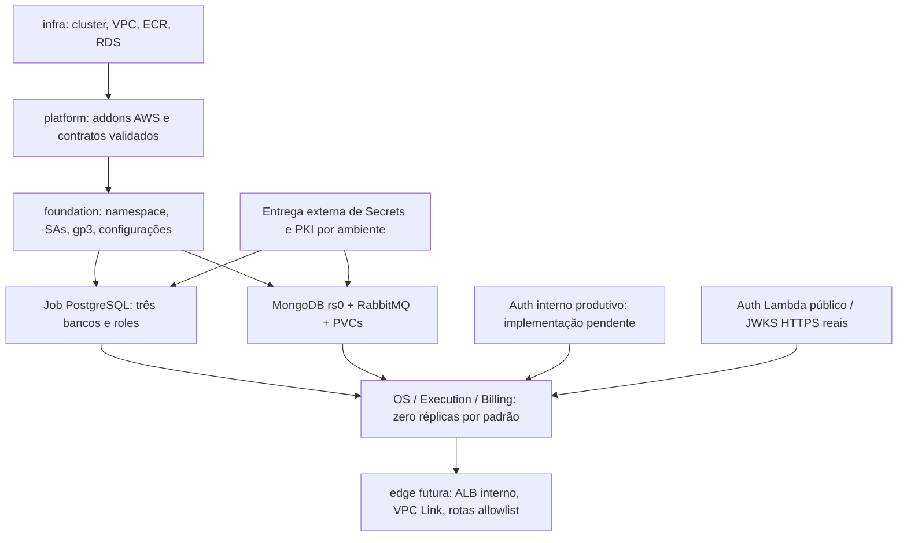

# Etapa 9.2.3 — Platform Kubernetes

Data: 2026-10-31. Proposta local para revisão, sem infraestrutura implantada.
Não houve AWS CLI, plan conectado, apply/destroy, kubectl, Helm em cluster,
alteração de state remoto, deploy, commit ou push. O catálogo permanece disabled.

## 1. Inspeção e proveniência

A 9.2.2-B já está versionada: `d8e0bdd330cd9db89e9f0c0ba6dce2207e70cdf8`
(`feat(infra): define ephemeral AWS foundation for phase 4`). A árvore inicial
do k8s-infra estava limpa, branch homolog. Não foram sobrescritas mudanças locais.

| Repositório consultado | Ref e HEAD observado | Estado |
| --- | --- | --- |
| k8s-infra local/remoto | homolog / d8e0bdd330cd9db89e9f0c0ba6dce2207e70cdf8 | local limpo inicialmente |
| Auth local | homolog / 34f5c229e73ddc6d1950be977a5e2775a93bab74 | limpo, anterior ao snapshot remoto |
| database-infra local | homolog / d1d24d68679b7002dd46182b8983cfcc221ddafe | README.md já modificado; preservado |
| Auth remoto | homolog / 88fe949df9216fd861a2ad3844f2b0e5867883f6 | snapshot GitHub somente leitura |
| database-infra remoto | homolog / 16abd2603b83b92d800b0b6fa237f40165eaa624 | snapshot GitHub somente leitura |
| OS remoto | homolog / 9391d3b9d4a5949a2c6447fc01becbb87d45142e | snapshot GitHub somente leitura |
| Execution remoto | homolog / 929c6de05e6b482d82fd097e6cd61ac1d38f9b30 | snapshot GitHub somente leitura |
| Billing remoto | homolog / c87c72f69c44978ff1211e19c582dd0c6ec2a6ad | snapshot GitHub somente leitura |

Não há working tree remoto para classificar como limpo/sujo. Checkouts locais
atuais de OS/Execution/Billing não foram localizados; não se afirma conhecer
suas alterações não publicadas. O Git de Auth/database foi consultado com
safe.directory apenas por comando, sem alterar configuração global.

Foram lidos os Dockerfiles produtivos de OS/Execution/Billing, application.yml,
decoders RS256, adapters mTLS e controller interno OS, configurações Rabbit,
AuthHandler/AuthDatabase/MigrateIdentity/KeyProvider/SigningKey, verificador
interno Auth e runtime E2E. As refs imutáveis acima permitem reproduzir a leitura.
Fontes: [OS](https://github.com/AuroNet0/tech-challenge-oficina-os-service/tree/9391d3b9d4a5949a2c6447fc01becbb87d45142e),
[Execution](https://github.com/AuroNet0/tech-challenge-oficina-execution-service/tree/929c6de05e6b482d82fd097e6cd61ac1d38f9b30),
[Billing](https://github.com/AuroNet0/tech-challenge-oficina-billing-service/tree/c87c72f69c44978ff1211e19c582dd0c6ec2a6ad),
[Auth](https://github.com/AuroNet0/tech-challenge-oficina-auth/tree/88fe949df9216fd861a2ad3844f2b0e5867883f6).

Também foram examinados README/compose da [8.3.5](https://github.com/AuroNet0/tech-challenge-oficina-billing-service/tree/c87c72f69c44978ff1211e19c582dd0c6ec2a6ad/integration/8.3.5)
e README/compose/memory-analysis da [9.1.4](https://github.com/AuroNet0/tech-challenge-oficina-billing-service/tree/c87c72f69c44978ff1211e19c582dd0c6ec2a6ad/integration/9.1.4).
O E2E usa JDK/JARs montados, compila AuthLocalRuntime na inicialização e não
usa os Dockerfiles produtivos. Os 641 testes Maven e 206 E2E informados pelo
usuário não foram reexecutados nesta etapa nem apresentados como testes AWS.

## 2. Arquitetura e ownership



Terraform platform declara somente AWS Pod Identity Agent, VPC CNI, EBS CSI,
role/policy/associação CSI e guard. Não usa provider Kubernetes/Helm nem token
em state. Os recursos Kubernetes são manifests parametrizados em locals HCL,
exportados por `manifests` como cinco Kubernetes Lists JSON, válidos como YAML 1.2.
O executor futuro deverá distribuir/aplicar esses bundles por fases; Terraform
não os aplica e seu destroy sozinho não remove objetos Kubernetes.

Bundles: `foundation`, `network`, `data`, `bootstrap`, `applications`. A separação
permite instalar controllers antes dos PVCs, entregar secrets antes dos pods e
esperar bootstrap antes das aplicações, sem uma pipeline nova nesta etapa.

## 3. Contrato infra/platform/edge

Input obrigatório `infra_contract`: objeto `platform_contract` da mesma infra,
fornecido explicitamente, nunca terraform_remote_state ou outputs legados.
Guard confere environment/account/region/prefix/tags, ARN/nome do cluster, VPC,
subnets, endpoint/CA e identidade STS observados pelos data sources AWS. Esses
reads só acontecerão em plan futuro autorizado; os testes atuais os substituem
por mocks. Provider também exige allowed_account_ids. Catálogo disabled bloqueia
recursos, mas não impede que um provider consulte identidade durante plan: o
preflight do resolvedor continua obrigatório antes de qualquer execução real.

ECR de aplicações precisa ser o endereço exato da conta/região/prefixo/serviço;
todas as seis imagens exigem digest SHA256. RDS exige hostname do identificador
do ambiente, região, secret ARN da conta e três bancos/roles distintos. CIDR
precisa corresponder a demo-a/demo-b e cluster real às privadas fornecidas.

Outros inputs: images, addon_versions completos e new_relic_chart_version exata.
As versões/digests operacionais não têm defaults inventados; precisam de revisão
de disponibilidade/compatibilidade antes do plan. Exemplos em tests são
**fixtures sintéticas**, inclusive conta, URLs, versões e digests; nunca implantá-los.

`jwt=null` permite preparar somente fundação/dados: bundle applications vazio.
Com issuer/audience/JWKS reais, os três Deployments são renderizados com zero
réplicas. Para uma réplica, exige acknowledgements de runtime Auth aprovado,
bootstrap concluído, entrega de secrets e enforcement de NetworkPolicy. Flags
são confirmações operacionais, não provas automáticas de readiness externa.

Edge recebe namespace, Services HTTPS 8443, rede privada e bloqueio de rotas
`/internal/*`. `listener_ready=false` e `alb_listener_arn=null`: não há ALB fictício.
O contrato do AWS Load Balancer Controller informa cluster/VPC/privadas/SG, mas
**sua policy IAM, chart/release e regras ALB->pods ainda não são implementados**.
Devem anteceder o futuro Ingress interno. Não existe Ingress público nesta stack.

## 4. Namespace, RBAC e segurança dos pods

Namespace = prefixo exclusivo do ambiente. Labels identificam fase/ambiente e
componente; Pod Security Admission restricted é fixado na versão minor EKS.
SAs distintas, sem montagem de token e sem RoleBinding/ClusterRoleBinding de apps.
Nenhuma aplicação recebe cluster administrator, IAM role ou permissão de ler
Secrets pela API. A montagem do Secret é feita pelo kubelet.

Pods são non-root, seccomp RuntimeDefault, sem elevação de privilégio, todas as
capabilities removidas, root filesystem read-only e sem hostNetwork/hostPID/hostPath.
JVMs usam UID/GID 10001, /tmp gravável e TLS/RDS CA read-only. Mongo/Rabbit usam
UID/GID/fsGroup 999 e PVC gravável. Confirmar esses usuários/ferramentas nos
digests selecionados antes de implantar; schema estático não executa imagens.

Default deny ingress/egress, DNS para CoreDNS, conexões internas estritas por
podSelector e HTTPS externo somente para os serviços de negócio, excluindo
RFC1918, loopback e link-local. Execution não recebe regra PostgreSQL; Mongo
aceita somente Execution; Rabbit aceita os três serviços em 5672. RDS é permitido
apenas das identidades OS/Billing/Auth/bootstrap em 5432 nas privadas da infra;
SG e credenciais independentes complementam o filtro. Não há entrada externa
para os Services; edge precisará adicionar regra restrita para o ALB privado.

VPC CNI é adotado como addon gerenciado com network policy habilitada. OVERWRITE
no create é deliberado exclusivamente para os componentes bootstrap do cluster
efêmero; update é NONE. preserve=true conserva o CNI no cluster ao remover o
gerenciamento do addon, mantendo rede até a exclusão posterior do EKS por infra.
Não usar para adotar cluster legado. Versão/compatibilidade
e schema do addon precisam ser verificados no provisionamento. O modo padrão do
agente pode permitir tráfego antes de programar as policies; validar enforcement
e startup antes de iniciar apps. Um modo strict exige revisão das policies de
CoreDNS/componentes de sistema, não apenas alteração isolada de uma flag.
Referência: [NetworkPolicy no EKS](https://docs.aws.amazon.com/eks/latest/userguide/cni-network-policy-configure.html).

## 5. MongoDB

StatefulSet de um membro, rs0, PVC gp3 5 GiB, headless Service e hostname estável.
Keyfile vem de Secret, copiado por initContainer non-root para memória com modo
0400. Credenciais root e aplicação são distintas; apenas Mongo recebe root.
Mongod inicia com auth/keyFile/replSet; não há listener standalone sem autenticação.

`mongo-init.js`, executado por postStart, usa conexão localhost para iniciar rs0
e criar o primeiro administrador pela localhost exception; espera PRIMARY, cria
usuário readWrite somente em oficina_execution e valida configuração existente.
Não recria usuário nem troca senha em reinício. Credencial antiga incorreta ou
role mais ampla causa falha; não reseta autenticação. Readiness autentica o usuário
da aplicação e exige PRIMARY e setName rs0. Cache WiredTiger é 0.25 GiB.
Referências: [keyfile](https://www.mongodb.com/docs/v8.0/tutorial/enforce-keyfile-access-control-in-existing-replica-set/)
e [localhost exception](https://www.mongodb.com/docs/v8.0/core/localhost-exception/).

Execution recebe MONGO_HOST/PORT/DATABASE/AUTH_DATABASE/USERNAME/PASSWORD compatíveis
com o YAML real, que exige replicaSet=rs0 e directConnection. Gerar senhas Mongo
de alta entropia no alfabeto base64url/hex para não quebrar a interpolação URI
do código atual; caracteres reservados exigiriam encoding/configuração adicional.
Uma réplica permite transações, mas não oferece HA nem tolerância a perda do volume.

## 6. RabbitMQ

StatefulSet de uma réplica, PVC gp3 5 GiB, node name FQDN estável, cookie Secret
copiado com 0600 e Service headless somente 5672. Management 15672 não tem Service
nem regra de ingresso. Healthchecks usam diagnostics; memória watermark 384 MiB.

`rabbitmq-definitions/definitions.json` deve ser entregue com vhost `/oficina`,
três usuários distintos, password_hash/salt corretos da versão escolhida, sem
tags administrativas nem usuário guest e com permissions restritas:

| Usuário lógico | Configure/write | Read |
| --- | --- | --- |
| OS | exchanges oficina.*, execution.diagnostic.start declarada pelo OS | os.saga.events e DLQ |
| Execution | exchanges oficina.* e execution.* | execution.* |
| Billing | exchanges oficina.* e billing.* | billing.* |

Validar regexes efetivas e hash com a versão selecionada antes de uso. Não incluir
queues/exchanges/bindings nas definitions: as aplicações são as donas dessas
declarações duráveis. OS declara oficina.commands/events/events.dlx, fila de
diagnóstico e os.saga.events/DLQ; Execution declara diagnostic.start/repair.start/
repair.cancel, retries e DLQ; Billing declara quote.create/payment.request,
retries e DLQ. Essa decisão evita argumentos divergentes de TTL/DLX/queue type.
Mnesia/PVC e node name preservam topologia/mensagens após restart; exclusão do PVC
perde os dados. Não compartilhar credenciais de administração entre serviços.

## 7. Bootstrap PostgreSQL e Flyway

Job usa imagem PostgreSQL 17/psql por digest, conexão RDS verify-full e CA pública
em ConfigMap rds-ca. A senha master continua gerenciada pelo RDS; um futuro
executor OIDC obtém AWSCURRENT e injeta Secret temporário postgres-bootstrap-admin
apenas para o Job. A SA não tem IAM, token ou leitura de Secrets Manager.

O mesmo executor cria previamente senhas independentes em fontes canônicas
por serviço e entrega auth-postgres/os-postgres/billing-postgres. Username deve
coincidir com infra_contract. Nunca usar a senha master como senha de aplicação.

`bootstrap.sql` usa psql sem rc/echo, erros somente SQLSTATE e variáveis obtidas
do ambiente. Um advisory lock serializa criação; CREATE DATABASE é executado fora
de transação com gexec. Identificadores/literais são escapados com format %I/%L;
não concatena entrada livre. Recusa roles privilegiadas/membro de outras roles
e bancos existentes com owner divergente. Cria somente bancos/roles ausentes,
revoga PUBLIC e grants cruzados, define owner/schema e default privileges por DB.
Concede temporariamente membership das roles ao administrador para operar como
owner e revoga ao fim. Falha parcial é reparável por repetição; manter concurrency
por ambiente no futuro executor, pois conexões por DB não compartilham o lock inicial.

Role existente não tem senha rotacionada silenciosamente. Após o SQL, o Job testa
login com cada credencial de aplicação; divergência falha, exigindo rotação
coordenada. Nenhuma senha é argumento de linha de comando/arquivo versionado ou
output; revisar auditoria/log_statement do RDS para não registrar DDL com senha.
Remover Secret administrativo e conferir memberships após sucesso/falha. TTL do
Job não remove Secrets e não substitui esse cleanup.

OS/Billing mantêm Flyway startup e ddl-auto=validate; initContainers autenticam
no próprio DB e aguardam bootstrap. JDBC recebe sslmode=verify-full/sslrootcert,
pool máximo 3 e mínimo idle 0. Auth deve executar MigrateIdentity em Job separado
usando sua futura imagem e exclusivamente a credencial Auth. Não foi inventada
uma imagem de migração Auth inexistente. Nunca permitir Execution no PostgreSQL.

SQL/roles e a configuração RDS precisam de teste de integração PostgreSQL 17
antes do uso AWS: não foram executados em banco nesta etapa. Docker daemon local
estava indisponível; isso não foi considerado um teste de idempotência SQL aprovado.

## 8. Aplicações e Auth interno

OS/Execution/Billing têm Deployment/Service independentes, digest ECR, perfil
mtls, porta 8443, Recreate, probes de startup/liveness/readiness e heap -Xmx384m.
O comando preserva o JAR real /app/app.jar dos Dockerfiles inspecionados, sem
compilar harness no pod. Não usa JAVA_TOOL_OPTIONS contendo senha: a JVM imprime
essa variável no startup. Passwords dos keystores são expandidos sem shell trace.

Probes HTTPS nativas do kubelet testam os endpoints reais permitAll. Kubernetes
[não verifica o certificado nessas probes](https://kubernetes.io/docs/concepts/workloads/pods/probes/);
elas não são evidência de mTLS/SAN. Nenhum cliente de negócio usa trust-all.
OS não possui curl em sua imagem produtiva; não se declarou probe exec fictícia.
As verificações criptográficas precisam de testes separados entre clientes reais.

**AuthLocalRuntime não é produtivo**: fica em integration/8.3.5, exige
AUTH_ENVIRONMENT=local, usa LocalKeySource e expõe login/JWKS via adaptação de
eventos Lambda. O AuthHandler produtivo só aceita login/JWKS, não rota interna.
Não há Dockerfile Auth no snapshot inspecionado. Por isso há apenas Service,
ServiceAccount, secret/PKI/DB contracts, sem Deployment Auth ou imagem inventada.

Mudança mínima necessária no repositório Auth, sob aprovação separada:

1. Reutilizar VerificarAcessoClienteUseCase, IdentityTransaction/
   JdbcIdentityTransaction, ClientAccessAuthentication/IdentidadeAcessoCliente,
   InternalClientAccessRequest, InternalUserTokenVerifier, AuthDatabase e Clock.
2. Implementar adapter HTTPS produtivo POST /internal/v1/identity/client-access/check:
   JSON estrito/limitado, issuedAt, requestId, resposta no-store e erros fail-closed;
   não reutilizar o wrapper local de login/JWKS nem AUTH_ENVIRONMENT=local.
3. Exigir certificado cliente real da sessão TLS, cadeia da CA do ambiente,
   EKU clientAuth, leaf não-CA e identidade OS esperada; nada de headers de proxy.
   Definir healthcheck compatível com mTLS obrigatório antes de criar Deployment.
4. Verificar JWT RS256 com issuer/audience/expiração e chave pública por JWKS HTTPS.
   InternalUserTokenVerifier aceita KeyProvider; implementar provider público com
   refresh/cache/rotação. SigningKey aceita privada null, mas suas janelas precisam
   ser mapeadas/testadas: não conceder acesso ao secret de assinatura apenas para
   satisfazer o provider do harness. ativa() não deve assinar nesse runtime.
5. Usar somente AUTH_DB_* de oficina_auth e verify-full. AuthDatabase não expõe
   sslrootcert por env atualmente: fornecer root.crt na localização JDBC do usuário
   da futura imagem ou aprovar configuração explícita dessa propriedade.
6. Criar Dockerfile Java 21 non-root, artefato com main produtivo e verificador de
   saúde, versão por digest no ECR auth; preparar Job MigrateIdentity separado.
7. Acrescentar testes TLS real: sem cert, CA errada, CN/SAN/identidade/EKU errados,
   JWT inválido/expirado/audience/issuer/kid/rotação, vínculo revogado, DB indisponível,
   limites de corpo/tempo, permissões DB e ausência de login/JWKS no adapter interno.

Nenhuma dessas mudanças foi feita no Auth. O adapter OS já exige CN exato dos
certificados Execution/Billing; o cliente Java valida SAN do servidor HTTPS.
Validação adicional de SAN do cliente no controller OS exigiria mudança aprovada
na aplicação: o código atual compara o subject CN e a sessão TLS.

## 9. JWT, mTLS e certificados

Issuer/audience compartilhados com Auth Lambda; JWKS público por HTTPS com cadeia
válida. Nenhum consumidor recebe chave privada de assinatura. URLs não são
substituídas por .invalid nem por endpoint E2E. jwt=null resolve a dependência:
fundação/dados primeiro; Auth público em edge em subetapa; depois render das apps
com URLs reais; ALB/VPC Link e rotas de negócio por último.

CA distinta por demo-a/demo-b. Leafs distintos por OS, Execution, Billing e
Auth interno, subject **somente CN=nome** para compatibilidade com o código real,
EKU serverAuth/clientAuth e DNS SAN curto + FQDN do Service. Não usar O/OU extras
sem adaptar a comparação estrita do código. `mtls_contract` explicita nomes/SANs.
Conexões: OS->Auth e Execution/Billing->OS, sem terminação intermediária que
descarte o certificado. SERVER_SSL_CLIENT_AUTH=want nos Spring preserva entrada
humana JWT; as rotas internas continuam exigindo certificado no controller.

Geração futura fora de Terraform: CA privada protegida por ambiente, chaves
aleatórias, CSRs/SANs/EKU e validade curta compatível com a demonstração; distribuir
identity.p12/truststore.p12/password em Secret de cada serviço. Truststore JVM
deve conter **raízes públicas do JRE e CA interna**, pois também acessa JWKS e
Mercado Pago públicos. Montar somente a CA E2E quebraria essas conexões.

Não versionar chaves/keystores, não gerar tls_private_key com persistência em
state. Renovar antes da expiração: adicionar CA nova aos truststores, reiniciar
clientes, trocar leafs/reiniciar serviços e só então retirar CA antiga. Recreate
causa interrupção aceitável de demo. Revalidar handshake/identidade/SAN após cada
troca. Nenhum certificado foi gerado nesta etapa.

## 10. Fontes e entrega de Secrets

Estratégia: fonte canônica externa + projeção Kubernetes pelo futuro executor
manual OIDC, sem leitura de valores por Terraform, provisioners ou data sources
de Secrets. GitHub Environment Secrets guarda somente segredos externos
preexistentes (ex.: New Relic/Mercado Pago) quando essa for a fonte escolhida;
não duplicar o mesmo valor também em Secrets Manager sem necessidade.

Para credenciais efêmeras geradas, Secrets Manager mantém fonte canônica por
ambiente/serviço, com ownership; Kubernetes recebe somente as chaves necessárias.
RDS master permanece no secret gerenciado nativo e sua cópia Kubernetes é
temporária. Gerar roles/senhas uma vez e reutilizar após reinício; rotação exige
operação coordenada. Não gerar nova senha a cada render/redeploy.

`secret_contract` contém nomes, chaves, consumidores e origem, nunca valores:
auth/os/billing-postgres; mongodb-admin/keyfile; execution-mongodb;
rabbitmq-cookie/definitions e credenciais Rabbit por serviço; TLS por serviço;
Mercado Pago. New Relic licencia somente seu namespace próprio. Secrets não
são declarados vazios no Terraform: ausência bloqueia pods, não cria defaults.

Executor futuro deve restringir ARNs/tags à conta/ambiente, desativar debug/echo,
fazer entrega por stdin/cliente API sem valores em args/logs e remover buffers/
arquivos temporários privados. Kubernetes Secret base64 não é criptografia;
exigir proteção etcd/EKS, RBAC e acesso de operadores mínimo. Sem external-secrets
operator/CSI secrets adicional nesta etapa. Nenhum valor real foi fornecido.

CA RDS é material público em ConfigMap `rds-ca/ca.pem`, com origem AWS regional
em external_configmaps. Validar cadeia/checksum/expiração antes de distribuir.

## 11. Persistência e IAM CSI

StorageClass por ambiente, gp3 criptografado, WaitForFirstConsumer e reclaimPolicy
Delete. PVCs de Mongo/Rabbit usam a AZ do node selecionado pelo scheduler. A infra
atual fixa o node group na primeira AZ; não criar volumes antecipadamente noutra.
StatefulSets têm retenção whenDeleted=Delete/whenScaled=Retain: reduzir réplicas
não apaga dados; exclusão final exige revisão e confirmação de perda dos PVCs.

CSI usa Pod Identity para kube-system/ebs-csi-controller-sa. Trust restringe request
tags de cluster ARN/namespace/SA; policy AWS EKSClusterScoped exige tag do cluster
em volumes/snapshots e instâncias. Exige CSI v1.58+; o addon EKS fornece cluster ID
e o driver acrescenta automaticamente ebs.csi.aws.com/cluster-name. Não tentar
injetar essa chave reservada por extraVolumeTags/StorageClass. Tags adicionais
de ownership vêm da StorageClass/controller. Não anexa EBS privileges à role dos
nodes nem altera GitHub OIDC. Ver [requisitos de tagging e versão](https://docs.aws.amazon.com/eks/latest/best-practices/identity-and-access-management.html).
Referências: [trust Pod Identity](https://docs.aws.amazon.com/eks/latest/userguide/pod-id-role.html),
[session tags](https://docs.aws.amazon.com/eks/latest/userguide/pod-id-abac.html)
e [policy cluster-scoped](https://docs.aws.amazon.com/aws-managed-policy/latest/reference/AmazonEBSCSIDriverEKSClusterScopedPolicy.html).
Confirmar versão CSI que suporta esses parâmetros/tagging; sem AWS nesta etapa.

Não excluir role/associação/CSI antes de os volumes serem removidos. Retain/PVs
manuais, snapshots e finalizers precisam de inventário; apagar namespace ou cluster
não comprova que não há EBS órfão. Não remover finalizers para contornar limpeza.

## 12. Observabilidade e capacidade

Output observability prepara nri-bundle, versão obrigatória, lowDataMode,
infra/ksm/eventos/logging e existingSecret newrelic-license/licenseKey. Identidade
do cluster e nomes dos serviços são derivados do ambiente, sem filtros do
monólito. Recursos mínimos seguem a estratégia Fase 3, com limites de memória.
Não há dashboards, New Relic provider ou licenseKey em state.

**O chart não é instalado por esta root nem foi renderizado/validado com Helm**.
O executor futuro deve criar namespace de observabilidade, entregar a licença,
renderizar o chart pinado, revisar recursos e RBAC/hostPath/hostNetwork dos agentes
e instalar após aprovação. Esse namespace precisa de exceções controladas ao
PSA restricted das apps. APM Java não está empacotado nos Dockerfiles produtivos;
NEW_RELIC_APP_NAME é preparação de configuração, não instrumentação comprovada.
Logs/container metrics/restarts e eventos do cluster são as evidências iniciais.
Fonte: [nri-bundle](https://github.com/newrelic/helm-charts/tree/master/charts/nri-bundle).

| Componente | CPU requests planejados | RAM requests |
| --- | --- | --- |
| OS + Execution + Billing, uma réplica cada | 750m | 1536 MiB |
| MongoDB | 300m | 768 MiB |
| RabbitMQ | 150m | 384 MiB |
| Subtotal dos manifests principais | 1200m | 2688 MiB |
| Auth interno reservado, não declarado | aproximadamente 150m | aproximadamente 256 MiB |
| DNS/CNI/CSI/kube-proxy/controller ALB | aproximadamente 350–500m | aproximadamente 500–800 MiB |
| New Relic | aproximadamente 300m ou mais; parte por node | aproximadamente 496 MiB ou mais |

Somatório estimado 2000–2150m antes de reservas do sistema e Jobs. Um m7i-flex.large
tem 2 vCPU brutos; allocatable é menor. O conjunto completo pode deixar pods
Pending por CPU, apesar de haver RAM. Limits dos cinco containers principais
somam 5 CPUs/4352 MiB; picos simultâneos causam contenção. JVM -Xmx384m não é RSS.
New Relic/CSI/CNI por node aumentam o orçamento ao adicionar nodes.

Recomendação para demo completa: revisar `node_count=2` do mesmo tipo/mesma AZ
após medir manifests efetivos, agents e carga. **Infra não foi alterada** e ainda
tem um node. Sem medição não há garantia de capacidade; não reduzir requests
artificialmente para esconder Pending. Jobs são sequenciais e as aplicações
permanecem zero por padrão. Não há HA de bancos ou autoscaler.

## 13. Instalação/remoção futuras e runner

Instalação proposta:

1. Preflight de catálogo/STS/região/backend/cluster/contrato e aprovação manual.
2. Aplicar addons/identidade CSI e conferir CNI/policy agent/CSI saudáveis.
3. Aplicar foundation/network e conferir enforcement; distribuir CA RDS e Secrets.
4. Iniciar Mongo/Rabbit, conferir PRIMARY, login, filas/persistência após restart.
5. Executar Job PostgreSQL, validar isolamento/login e apagar Secret master temporário.
6. Implementar/aprovar Auth interno e sua migração; configurar Auth público/JWKS reais.
7. Distribuir certificados; iniciar Auth interno e apps sequencialmente com gates reais.
8. Renderizar/revisar/instalar observabilidade e controller ALB com IAM restrito.
9. Criar Ingress exclusivamente interno e depois edge/VPC Link/rotas allowlist; E2E.

Destruição coordenada:

1. Impedir deployments novos, drenar entrada/filas/outbox e coletar evidências.
2. Remover edge/VPC Link/integrações que consomem ALB, mantendo controllers ativos.
3. Remover Ingress/Services derivados e aguardar ALB/target groups/ENIs/SGs.
4. Remover workloads, Mongo/Rabbit e PVCs/PVs; aguardar CSI terminar exclusão EBS.
5. Confirmar zero volumes/VolumeAttachments/load balancers dependentes; remover
   observabilidade, controller ALB e CSI/identidades por último, então namespace.
6. Só liberar destroy infra após inventário sem dependências; RDS deve sobreviver
   até todos os consumidores e jobs terem sido encerrados. Limpar secrets externos
   efêmeros com confirmação e nunca apagar secret/bootstrap/state persistente.

Nenhum passo operacional foi executado ou automatizado. O runner aprovado será
GitHub-hosted + OIDC, com abertura **temporária /32** do IP do runner no endpoint
EKS e fechamento em sucesso/falha, além de recuperação de interrupção abrupta.
Esta etapa não abre o endpoint, não modifica infra e não implementa workflows.
CI Maven/JaCoCo/Sonar deve permanecer separado de deploy/destroy manuais; os
workflows dos serviços não foram editados. O workflow legado k8s permanece manual.

## 14. Validação e limitações

Ferramentas: Terraform 1.15.8, provider AWS 5.100.0, Node 22, kubeconform 0.8.0
obtido da release oficial com SHA256 conferido. TF_DATA_DIR exclusivo em TEMP,
backend desabilitado. Sandbox bloqueou leitura de checksum do provider; init e
testes locais foram repetidos com permissão ampliada apenas para ferramentas,
sem credenciais/conexão AWS. Não houve acesso ao EKS.

Testes Terraform cobrem catálogo disabled, render seguro, contrato de outro
ambiente, conta/cluster observado divergente, início indevido, imagem mutável,
fundação sem JWKS e Mercado Pago sem callbacks reais. Os casos positivos usam
override do módulo somente em memória; catálogo em disco continua inalterado.

`tests/check-manifests.mjs` lê o JSON verbose de terraform test, valida objetos,
identidades/referências, Services internos, secrets por referência, SecurityContexts,
SAs/RBAC, digests, probes/PVCs e executa seis cenários dos scripts Mongo em VM
simulada. Pode exportar bundles com nomes *.fixture.json em TEMP, marcados
TEST-FIXTURES-ONLY. Esses arquivos nunca são manifests operacionais.

Os manifests foram conferidos com kubeconform strict/schema 1.35.0. A primeira
checagem detectou booleano convertido em string em dois Services; a composição
dos objetos HCL foi corrigida e todos passaram. Isso comprova schema, não startup
real. Docker daemon indisponível impediu integração SQL/Mongo/Rabbit/imagens.
Helm New Relic/LBC, disponibilidade/schema AWS dos addons, enforcement e tráfego
mTLS/JWT, bind mounts rootless, persistência e E2E continuam **não aprovados em runtime**.

Reprodução local (somente ferramentas, mocks e fixtures):

```powershell
$env:TF_DATA_DIR = Join-Path $env:TEMP 'oficina-923-platform'
$env:CHECKPOINT_DISABLE = '1'
terraform -chdir=phase4/stacks/platform init -backend=false -input=false -lockfile=readonly
terraform -chdir=phase4/stacks/platform validate
$testArgs = @('-chdir=phase4/stacks/platform', 'test', '-json', '-verbose')
terraform @testArgs | Out-File (Join-Path $env:TEMP 'oficina-923-platform-tests.jsonl') -Encoding utf8
node phase4/stacks/platform/tests/check-manifests.mjs (Join-Path $env:TEMP 'oficina-923-platform-tests.jsonl')
terraform fmt -check -recursive
git diff --check
```

Conferir exit code de cada comando. Para kubeconform, passar arquivos exportados
pelo último argumento opcional do checker e usar strict/schema 1.35.0. Nenhum
destino de exportação de fixtures deve ser usado para deploy.
Resultados finais:

| Verificação | Resultado |
| --- | --- |
| terraform fmt -check -recursive | passou em todo o repositório |
| terraform validate: platform, infra, environment e edge | quatro configurações válidas, backend desabilitado |
| terraform test: platform | 10 passaram; zero falhas/erros/skips |
| terraform test: infra / environment | 7 / 6 passaram, respectivamente |
| Total Terraform | 23 testes passaram; nenhum apply ou plan conectado |
| Test-EnvironmentContract.ps1 | 19 verificações passaram |
| Sintaxe JS + checker de manifests/referências/segurança | passou; 48 objetos renderizados |
| Scripts MongoDB em VM simulada | seis cenários passaram, sem processo mongod real |
| kubeconform strict / Kubernetes 1.35.0 | 48 válidos; zero inválidos/erros/skips |
| YAML dos workflows | passou; único gatilho workflow_dispatch |
| git diff --check e whitespace de novos arquivos | passaram; somente avisos LF/CRLF do Git |
| Áreas preservadas | diff confirmou infra/edge/módulo/catálogo/scripts/workflows/bootstrap/legado intactos |
| SQL, containers reais, Helm, enforcement, TLS e E2E AWS | pendentes; não aprovados por testes estáticos |

Não considerar qualquer pendência acima como validação aprovada. Nenhuma validação
das roots legadas foi reexecutada: não houve mudanças nelas.

Git final: homolog / d8e0bdd330cd9db89e9f0c0ba6dce2207e70cdf8, cinco arquivos
rastreados modificados, 14 novos não rastreados e nada staged. Sem commit/push.
O README local já modificado de database-infra não foi tocado. O snapshot inicial
limpo do k8s-infra e os SHAs consultados estão na seção de proveniência.

## 15. Arquivos e próxima etapa

Alterados: README.md; platform/main.tf, variables.tf, versions.tf e o teste de
guard existente. Criados na platform: applications.tf, controllers.tf,
kubernetes.tf, network-policies.tf, outputs.tf, scripts/bootstrap.sql,
scripts/mongo-init.js, scripts/mongo-ready.js, tests/fixture.json,
tests/aws/defaults.tfmock.hcl, tests/platform.tftest.hcl,
tests/check-manifests.mjs e .terraform.lock.hcl. Criado este documento.

Prioridade seguinte: aprovar a adaptação produtiva do Auth interno e seus testes;
testar SQL e imagens localmente com Docker disponível; confirmar capacidade,
addons pinados, chart/role ALB e render Helm New Relic. Só então implementar edge
e os workflows manuais com entrega de secrets e cleanup coordenado. Nenhuma
afirmação de funcionamento AWS pode decorrer somente destes testes estáticos.
