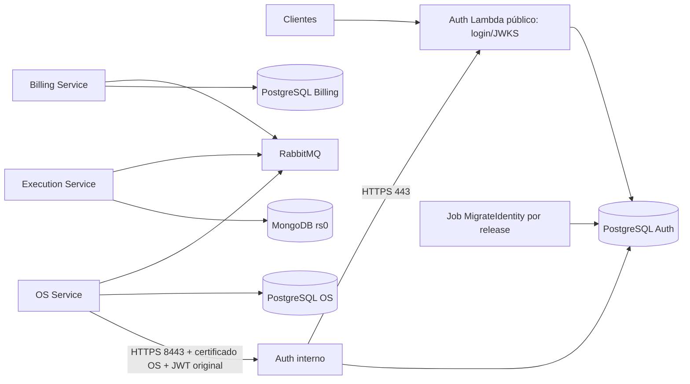

# Etapa 9.2.3.2 — Integração do Auth e validação local da Platform

Data: 02/11/2026. Alterações locais para revisão, sem commit ou push.
Esta entrega prepara contratos e manifests; **a Platform não está pronta nem
validada na AWS**. Nenhum apply/destroy, plan conectado, state remoto, AWS CLI,
deploy Kubernetes, publicação ECR ou workflow operacional foi executado/criado.
Os ambientes demo-a/demo-b continuam desabilitados.

## 1. Inspeção e arquitetura

O k8s-infra iniciou limpo em `homolog`, HEAD
`be61cb97951e5c184c5d7c7c848347f82f19060d`. A 9.2.3 está publicada: confirmada
pela referência local origin/homolog e pela consulta de seu commit no GitHub.
O Auth local também iniciou limpo, exatamente em
`dd10bbd3a31d2148ce111a996b908a48379bc3ba`, confirmado no GitHub.
Nenhum repositório de aplicação foi alterado.

Foram inspecionados todos os arquivos Platform, SQL/scripts Mongo, testes,
contratos/controllers, scripts e validações da 9.2.2-A, infra EKS/ECR/RDS e o
documento 9.2.3. No Auth foram lidos a 9.2.3.1, Dockerfile, InternalAuthMain,
InternalAuthServer, InternalTls, InternalHealthProbe, TrustedJwksProvider,
AuthDatabase e MigrateIdentity. O MtlsClientAccessAdapter do OS foi consultado
na branch homolog pelo GitHub, blob `7e247ec3fb5a1f5ee93ba78d35b80a4d8c0b5305`.



Infra continua responsável por rede/EKS/ECR/RDS/IAM de base. Platform exporta
Lists JSON (subconjunto YAML) e declara seus addons AWS, sem provider Kubernetes
ou Helm. Edge continua separada. Terraform não aplica os bundles nem comprova
sua existência/remoção por state. Foram acrescentados bundles `auth` e
`migration`, preservando foundation/network/data/bootstrap/applications.

## 2. Deployment Auth interno

`auth-internal.tf` declara ConfigMap e Deployment próprios, reutilizando Service
ClusterIP e ServiceAccount auth-internal. Porta nomeada https:8443 e appProtocol
HTTPS. Não há Ingress, NodePort, LoadBalancer ou listener HTTP alternativo.
DNS consumido pelo OS e presente no SAN:
`auth-internal.<prefixo-do-ambiente>.svc.cluster.local`.

O Deployment não define command/args: preserva o ENTRYPOINT Java explícito para
InternalAuthMain e JAVA_TOOL_OPTIONS da imagem produtiva. Não usa `java -jar`
nem AuthLocalRuntime. UID/GID/fsGroup 10001, non-root, seccomp RuntimeDefault,
readOnlyRootFilesystem, allowPrivilegeEscalation=false, drop ALL, sem token de SA.
Secrets 0440 (decimal 288) e CA são montados readonly. `/tmp` tem emptyDir limitado
a 128 MiB para temporários/JVM; não há escrita persistente do Auth no container.
terminationGracePeriodSeconds=45 e estratégia Recreate.

Requests 250m/512Mi e limits 1000m/768Mi correspondem à 9.2.3.1. Startup/liveness
usam GET HTTPS `/health/live`; readiness usa `/health/ready`, timeout 5 s. O socket
pede certificado opcional; a rota de autorização exige a identidade TLS real.
Probes não recebem certificado OS. HTTPGet HTTPS do kubelet não valida o
certificado servidor; não é evidência criptográfica de mTLS.

## 3. Contrato de imagem e habilitação

`images.auth` é opcional/null. Sem imagem ou sem jwt, bundle auth fica vazio:
nenhuma imagem fictícia é usada como fallback. Uma referência fornecida exige
`<conta>.dkr.ecr.<região>.amazonaws.com/<prefixo>-auth@sha256:<64 hex>`.
Tags, latest e origem de outro ambiente são rejeitadas. Infra já declara ECR auth;
nenhuma mudança de infra foi necessária.

Formato não prova existência/proveniência. `auth_image_verified=false` por padrão
exige futura evidência externa de digest publicado, build do commit dd10bbd,
arquitetura e testes. As fixtures com a/b repetidos são exclusivamente testes de
renderização com mocks; não são imagens prontas nem referências operacionais.

`application_replicas=0` permanece padrão para os quatro serviços. Uma réplica
exige jwt real, imagem Auth, auth_image_verified, auth_migration_completed,
auth_internal_runtime_approved, bootstrap_completed, secrets_delivered e
network_policy_enforced. Esses flags são atestações operacionais, não sondas
automáticas da AWS. `runtime_available=true` no output significa código produtivo
disponível no Auth; deployment_rendered/enabled/image_verified distinguem os
outros estados. Nada foi habilitado nesta entrega.

## 4. ConfigMap e Secrets

Matriz compatível com os 18 inputs da 9.2.3.1; validada também no checker:

| Input | Origem/valor |
| --- | --- |
| AUTH_INTERNAL_PORT | ConfigMap: 8443 |
| AUTH_INTERNAL_KEYSTORE | /tls/identity.p12 |
| AUTH_INTERNAL_TRUSTSTORE | /tls/truststore.p12 |
| AUTH_INTERNAL_KEYSTORE_PASSWORD | auth-internal-tls/password |
| AUTH_INTERNAL_TRUSTSTORE_PASSWORD | auth-internal-tls/password |
| AUTH_INTERNAL_OS_SUBJECT | CN=os-service |
| AUTH_INTERNAL_PROBE_HOST | FQDN do Service, incluído no SAN |
| AUTH_DB_HOST / AUTH_DB_PORT | RDS do mesmo contrato / 5432 |
| AUTH_DB_NAME | application_databases.auth.database |
| AUTH_DB_USER / AUTH_DB_PASSWORD | auth-postgres/username e password |
| AUTH_DB_SSLMODE | verify-full |
| AUTH_DB_SSLROOTCERT | /rds-ca/ca.pem |
| AUTH_INTERNAL_DB_POOL_SIZE | 2 |
| AUTH_JWT_ISSUER / AUTH_JWT_AUDIENCE / AUTH_JWKS_URI | Mesmo var.jwt do emissor Lambda |

`secret_contract` documenta nomes/chaves/consumidores; não cria nem lê valores.
auth-migration-postgres é novo, temporário no cluster, com fonte canônica externa.
Seu username deve ser `<application_databases.auth.username>_migrator`.
auth-postgres usa o username original do contrato. São senhas diferentes;
nenhuma delas é a master RDS. O nome base Auth tem limite 54 caracteres para
comportar o sufixo, sem colisão com OS/Billing.

**A entrega de Secrets/PKI ainda não possui mecanismo operacional implementado.**
Um executor autorizado deverá gerar/obter valores das fontes do ambiente,
validar nomes/identidades, projetar pela API sem echo/debug, conferir acesso e
remover o Secret master após bootstrap e o Secret migrador após migração. Não
armazenar valores em tfvars, outputs, state, argumentos reais ou arquivos Git.
Retenção da senha canônica para próxima release não implica mantê-la no cluster.
Kubernetes Secret/base64 exige RBAC e proteção do armazenamento; não é criptografia.

## 5. Certificados e mTLS

CA técnica exclusiva por ambiente, com emissão controlada e validade curta.
Auth: leaf serverAuth, SAN auth-internal e FQDN do Service. OS: certificado
distinto, clientAuth, Subject X.500 exato `CN=os-service`; não acrescentar O/OU
sem revisar o contrato de igualdade. OS também precisa serverAuth para seus
consumidores internos. Não é necessário SAN localhost no Auth Kubernetes:
AUTH_INTERNAL_PROBE_HOST aponta ao FQDN. Docker local pode usar localhost.

auth-internal-tls contém identity.p12, truststore.p12 e password. Seu truststore
de entrada confia **somente na CA técnica do ambiente**, não nas roots públicas.
TrustedJwksProvider usa o SSLContext padrão da JRE, separado desse store.
O cliente OS usa seu keystore e truststore JSSE já configurados em applications.tf;
o store de saída OS precisa conter roots públicas e CA técnica para verificar
JWKS/Auth por HTTPS. Não foi alterado unilateralmente seu adapter.

Montagens readonly/0440 e fsGroup permitem leitura por 10001. Nenhuma chave
privada de CA/leaf de produção foi gerada/versionada. Rotação dos stores exige
rollout antes do vencimento; não há revogação online implementada no runtime.
O teste local gera somente certificado PostgreSQL descartável em volumes Docker,
removidos ao fim; isso não instala PKI Kubernetes nem comprova SAN em EKS.

## 6. JWT/JWKS e contrato OS

POST `/internal/v1/identity/client-access/check` é exatamente o caminho exigido
pelo adapter OS. Envelope: clienteId, userAccessToken original do
JwtAuthenticationToken, requestId UUID e issuedAt. O cliente exige booleano
estrito e Cache-Control no-store; conexão 2 s/chamada 3 s. Não existe rota pública
nova de autorização, emissão de token ou login no Auth interno.

O runtime verifica RS256, issuer/audience e temporalidade; usuário deriva do sub
verificado, e vínculo/atividade/papel atuais são consultados no banco Auth.
TrustedJwksProvider usa HTTPS com hostname/CA válidos, sem redirects, cache 30 s
sem stale-on-error. Indisponibilidade fecha autorização/readiness. Manter os
prazos de publicação/retenção de chaves do documento Auth. Relógios precisam
estar sincronizados. Não montar chave privada RS256 ou Secret do emissor no pod.
As configurações e implementação da Lambda pública não foram modificadas.

## 7. Migração única Auth

Bundle migration fica vazio por padrão. `auth_migration_enabled=true` apenas
renderiza o Job após confirmar imagem verificada, bootstrap, Secrets/CA e
dataplane. Job `auth-migrate-<git_revision[0:12]>-<digest-auth[0:12]>`, SA própria, completions=1,
parallelism=1, backoffLimit=0, deadline 300 s. Usa a mesma imagem Auth, com comando
explícito MigrateIdentity, sem TLS/JWT/signing Secrets do runtime. Não tem TTL:
preservar o Job concluído como evidência impede reexecução acidental ao reaplicar
a mesma release. Retenção/limpeza pertence ao executor futuro.

Executar antes de disponibilizar tanto Lambda quanto Auth interno; não migrar
por réplica/initContainer. Serializar releases e impedir Jobs de SHAs diferentes
simultâneos. Flyway locking é proteção adicional, não substitui essa serialização.
A classe existente usa cleanDisabled(true), migrate e validate; nunca clean.

AuthDatabase.criar(env, true) lê AUTH_DB_SSLROOTCERT; MigrateIdentity usa o
overload público e **não lê essa variável**. O Job define `-Duser.home=/home/auth`
e monta rds-ca/ca.pem como `/home/auth/.postgresql/root.crt`, caminho padrão do
PostgreSQL JDBC. Essa combinação foi validada na imagem real: verify-full com
CA montada migrou V1/V2 e validou duas vezes; sem CA falhou. A CA local é de teste:
bundle RDS regional válido ainda precisa ser obtido, verificado e instalado.

## 8. Bootstrap PostgreSQL 17

SQL mantém três bancos lógicos exclusivos. OS/Billing preservam seus owners
porque executam Flyway no startup. Auth passa a ter owner/migrador separado,
`<auth_user>_migrator`, sem superuser/CREATEDB/CREATEROLE/replication/bypassrls.
Runtime Auth mantém `<auth_user>` e recebe USAGE no schema, DML nas tabelas e
USAGE/SELECT em sequences; não recebe CREATE, ownership ou membership migrador.
Default privileges do migrador permitem tabelas V1/V2 futuras e SELECT FOR UPDATE.
O mesmo runtime role pode atender à persistência pública da Lambda, sem alterar
seu código/configuração nesta entrega. Revisar grants extras para futuras tabelas
e funções; não conceder acesso a bancos OS/Billing.

Banco Auth criado pela proposta 9.2.3 tinha owner runtime: agora será recusado
como owner inesperado. Não há transferência silenciosa. Antes de adotar banco
existente, executar revisão autorizada de ownership/objetos/grants, ou recriar o
banco descartável após aprovação de perda. Não foram acessados bancos reais.

Idempotência: cria somente roles/bancos ausentes; usa format %I/%L, não troca
senhas existentes, recusa roles privilegiadas/NOLOGIN/memberships e owner
divergente. Revoga PUBLIC/grants cruzados e memberships temporárias do admin.
Reexecução preserva dados e completa falha parcial. Advisory lock cobre a fase
inicial; conexões por banco liberam esse lock. Serializar o bootstrap completo
externamente e verificar/remover memberships administrativas após qualquer falha.

ECHO/HIDDEN desligados, erros SQLSTATE e variáveis de ambiente evitam imprimir
senhas. Sessão inicial define log_statement=none e log_min_error_statement=panic
antes do DDL de senhas. Isso foi testado em PostgreSQL 17 local; permissões de
sessão, pgaudit e parâmetros RDS ainda exigem revisão. Se essas configurações
forem recusadas, o SQL para antes de criar senhas; não contornar expondo DDL em
logs. Job também testa login dos três runtimes; divergência de senha é erro,
não rotação automática. O role master só é usado pelo bootstrap temporário.

## 9. MongoDB e RabbitMQ

Mongo mantém StatefulSet de um membro rs0, auth/keyfile, usuário readWrite
exclusivo Execution e PVC 5Gi. Scripts reais foram executados em Mongo 8.0:
PRIMARY autenticado, transação com commit, repetição de init, restart e manutenção
dos dois documentos, negação de leitura anônima. Rootfs readonly/UID999 e keyfile
0400 foram usados. O membro local localhost é adaptação do teste Docker; DNS
StatefulSet/PVC/EBS Kubernetes não foram exercitados. Não há HA.

Rabbit mantém StatefulSet/PVC 5Gi, cookie Secret e Service interno AMQP 5672.
Definitions do ambiente devem criar vhost /oficina e três usuários com hashes e
permissões restritas; as aplicações continuam donas de exchanges/queues duráveis.
Não versionar senhas ou introduzir topologia concorrente no bootstrap Rabbit.

Teste representativo com UID/GID999, rootfs readonly, volume/cookie e cliente
AMQP Pika 1.3.2: autenticação correta/incorreta, exchange/queue duráveis,
mensagem persistente com publisher confirm e consumo após restart/reconexão.
O cliente usa rede Docker própria; nenhum listener foi publicado no host.
Não reproduz definitions de produção nem todas as retries/DLQs/Sagas das apps.

O primeiro teste Rabbit usando entrypoint/default user da imagem Alpine falhou
por permissão do cookie. A imagem usa UID100/GID101, enquanto o contrato força
999. Preparar o volume/cookie e executar explicitamente como 999 reproduziu o
contrato com sucesso. Na Platform fsGroup999 prepara o PVC e initContainer999
copia o cookie 0600. Confirmar acesso efetivo do CSI no futuro deploy.

## 10. NetworkPolicies e DNS

Default deny preservado. OS→Auth 8443 nos dois sentidos de policy, Auth→subnets
RDS 5432, Auth com label business para egress HTTPS público 443 e DNS TCP/UDP53
para CoreDNS. Job auth-migrate recebe somente DNS e PostgreSQL. Services e
containers agora têm nomes de portas iguais (https/mongo/amqp).

NetworkPolicy padrão não filtra por FQDN: regra public-https permite TCP443 em
IPs públicos, excluindo redes privadas/link-local/loopback. Não é uma allowlist
exclusiva do hostname JWKS; URI fixa e validação HTTPS são controles adicionais.
RDS rule abrange subnets privadas para tolerar mudança de IP; SG RDS e credencial
lógica continuam necessários. Não foram abertos CIDRs de nodes para negócio.

VPC CNI declara enableNetworkPolicy=true. Para EKS, confirmar versão/schema
compatíveis com Kubernetes 1.35, Linux/AL2023/kernel, agente aws-network-policy,
CRD PolicyEndpoint, permissões e políticas programadas. As versões em tests são
sintéticas. Modo standard pode ter janela permissiva inicial; strict exige
revisão adicional de DNS/sistema antes de habilitar. Não há evidência de enforcement
de dataplane nesta etapa. network_policy_enforced permanece false.

Tráfego do kubelet do próprio node ao pod é permitido pelo modelo Kubernetes;
validar origem real/CNI/SG e probes após instalação. Não simular mTLS em probes
nem abrir ingresso público para contornar falhas. Referências primárias:
[VPC CNI policies](https://docs.aws.amazon.com/eks/latest/userguide/cni-network-policy.html),
[configuração](https://docs.aws.amazon.com/eks/latest/userguide/cni-network-policy-configure.html),
[NetworkPolicy e nodes](https://kubernetes.io/docs/concepts/services-networking/network-policies/).

## 11. Recursos e capacidade

| Componente, uma réplica | CPU request / limit | Memória request / limit |
| --- | --- | --- |
| OS | 250m / 1000m | 512Mi / 768Mi |
| Execution | 250m / 1000m | 512Mi / 768Mi |
| Billing | 250m / 1000m | 512Mi / 768Mi |
| Auth | 250m / 1000m | 512Mi / 768Mi |
| MongoDB | 300m / 1000m | 768Mi / 1280Mi |
| RabbitMQ | 150m / 1000m | 384Mi / 768Mi |
| Subtotal principal | 1450m / 6000m | 3200Mi / 5120Mi |
| New Relic renderizado, um node | 300m / CPU parcialmente ilimitada | 496Mi / 1536Mi |
| ALB controller proposto | 100m / 500m | 128Mi / 256Mi |
| CNI/DNS/kube-proxy/Pod Identity/CSI | estimativa conjunta 350–500m; medir charts/addons | estimativa 500–800Mi; medir |

Requests totais estimados 2200–2350m/4324–4624Mi, antes dos Jobs e reservas de
sistema. Limits principais+NR+ALB somam 6912Mi, antes de addons/OS. CPU limits
permitem oversubscription e não reservam capacidade. O m7i-flex.large previsto
tem 2vCPU/8GiB nominais; allocatable é menor, dependendo de AMI, kube/system-reserved,
eviction e maxPods. Não foi consultado node real nem adotado 2 cores como allocatable.
Jobs bootstrap 100m/128Mi e migração 250m/512Mi devem rodar antes dos apps.
InitContainers têm pico de scheduling próprio, não somar todos continuamente.

A. Um node: opção experimental exige requests revisados com medição de carga,
reduzir/selecionar agentes opcionais e reservar explicitamente addons/sistema.
Exemplo para estudo, não aplicado: JVMs 150m cada, Mongo250m, Rabbit100m,
NR300m, ALB100m e sistema/addons350m = 1700m, com pouca margem para um node.
Riscos: throttling/latência OS de 3s, probes, OOM/eviction e indisponibilidade
total no restart. Reduzir request não reduz consumo; não liberar sem medição.

B. Dois nodes do mesmo tipo: recomendação para a demo completa pelos requests
atuais excederem 2vCPU brutos. Soma nominal 4vCPU/16GiB, menor como allocatable.
DaemonSets CNI/CSI/NR crescem por node; NR adiciona aproximadamente 150m/256Mi
por node (kubelet e logging). Não é duplicação de capacidade útil perfeita nem
HA dos bancos de um membro. Custo incremental: mais uma instância ON_DEMAND
do mesmo tipo (~100% do compute dos workers) e mais root gp3 de 30Gi, além do
overhead/ingestão; preço monetário regional deve ser cotado na etapa autorizada.
**node_count/infra não foram alterados.**

## 12. New Relic, EBS CSI e ALB

New Relic: nri-bundle 6.0.0 foi baixado do repo oficial e renderizado offline
com Kubernetes 1.35. Subchart infrastructure 3.46.0 usa kubelet.resources,
não kubelet.kubelet.resources/agent.resources. A renderização identificou esses
valores ignorados na base, agora corrigidos. controlPlane.enabled=false evita
scraper de componentes de control plane não expostos como pods no EKS. KSM,
logging e eventos permanecem; demais operadores/Pixie não são habilitados.

License vem de Secret externo newrelic-license/licenseKey no namespace
<prefixo>-observability. Chart gera SAs/RBAC por componente; não requer IAM AWS
para envio HTTPS ao New Relic. Revisar hostPath/privileged e exceções PSA só no
namespace de observabilidade, conectividade API/kubelet/DNS/HTTPS e RBAC mínimos.
Não foi instalada licença/agente. APM Java continua não empacotado nas imagens;
NEW_RELIC_APP_NAME não comprova instrumentação. Versão renderizar/schema passar
não certifica suporte do agente às métricas de um cluster EKS real.

ALB: contrato fixa chart 1.14.0/controller v2.14.0, clusterName/region/vpcId,
SA kube-system/aws-load-balancer-controller e recursos 100m/128Mi, limite
500m/256Mi. O chart gera SA/RBAC; identidade proposta é Pod Identity com role
restrita por cluster/namespace/SA. A policy upstream versionada está indicada no
output e ainda precisa ser revisada, limitada por VPC/tags e anexada à associação.
**Role/policy/associação ALB e release Helm não estão implementadas/instaladas.**
Sem depender de IMDS (hop limit atual 1). Service mutator e criação de
IngressClass são desabilitados; classe/roteamento pertencem a edge. Helm gera
Secret TLS de webhook somente no artefato temporário de render, não no Git;
provisionamento/rotação desse webhook precisam da instalação real.

EBS CSI preserva SA kube-system/ebs-csi-controller-sa, Pod Identity trust
restrito ao cluster e policy EKSClusterScoped. Versão exige v1.58+ por tagging,
mas disponibilidade EKS/schema/versão efetiva não foram consultados. Confirmar
Pod Identity Agent, tolerations, CSI controller/node Ready, provisionamento e
Delete real antes de habilitar workloads persistentes. Não instalar charts AWS
no teste. Fontes: [chart NR](https://github.com/newrelic/helm-charts),
[valores infrastructure](https://github.com/newrelic/nri-kubernetes),
[instalação LBC](https://kubernetes-sigs.github.io/aws-load-balancer-controller/latest/deploy/installation/).

## 13. Ordem de instalação futura

1. Revisar identidade/catalog/backend, aprovar ambiente e versões/digests reais;
   runner com acesso privado ao EKS. Plan/apply só em etapa autorizada.
2. Infra primeiro; confirmar cluster, allocatable, AZ, RDS17, rede e ECR.
3. Platform addons Pod Identity/CNI/CSI e validação de dataplane/SG/DNS.
4. Foundation/network; entregar CA RDS, PKI e Secrets do ambiente com preflight.
5. Data: Mongo PRIMARY/transações e Rabbit autenticação/topologia/persistência.
6. Bootstrap SQL; verificar ownership, grants, logins e remover Secret master.
7. Job migração Auth da release; aguardar Complete/validate, registrar evidência
   e remover Secret migrador. Não disponibilizar Lambda/Auth antes disso.
8. Dependência edge mínima para Lambda pública/JWKS HTTPS e sua CA RDS reconhecida
   pelo bootstrap público. Publicar somente login/JWKS, preservando contratos.
9. Validar imagem/Secrets/SAN/JWT; habilitar Auth e conferir readiness; depois
   microsserviços e seus fluxos JWT/mTLS/Rabbit/Saga. Medir timeout/pool/carga.
10. Observabilidade e ALB identity/controller com preflight de recursos; edge
    instala classe/ALB interno/VPC Link e rotas públicas allowlist por último.

As flags não substituem espera de Jobs/Pods nem testes das dependências.
O futuro executor pode aplicar os bundles por fases; nenhum workflow foi criado.

## 14. Ordem de destruição e checkpoints

| Fase | Verificação antes de avançar |
| --- | --- |
| Bloquear novos deploys | Congelar releases por ambiente; sem Job/deploy concorrente; registrar inventário e decisão de descarte |
| Remover edge e dependências ALB | Remover rotas/VPC Link/Ingress/TargetGroupBindings; manter controller/IAM/rede enquanto finalizers atuam |
| Confirmar ALB removido | Inventário AWS por ARNs/tags: nenhum LB/listener/target group/ENI dependente; ausência no state é insuficiente |
| Remover aplicações e Jobs | Réplicas/paralisação controladas; consumidores drenados; nada usando volumes/DB; reter evidências necessárias |
| Remover bancos internos/PVCs | Aprovação explícita de perda; conferir StatefulSet retention/reclaimPolicy, PVC/PV/finalizers e snapshots |
| Confirmar EBS removido | Conferir volume IDs físicos e attachments AWS, sem volumes/snapshots órfãos do ambiente; não remover finalizers à força |
| Remover controllers/observabilidade | Somente após ALB/EBS realmente ausentes: releases, RBAC, associações e IAM dependentes; CNI preservado até EKS |
| Infra por último | Sem LBs/volumes/dependências externas, confirmar exclusão RDS/EKS/ECR/rede e resíduos por tags/ARNs |

RDS é recurso de infra; bancos lógicos desaparecem com o RDS descartável ao fim,
sem workflow paralelo de drop. Auditar snapshot final/backups e políticas de
retenção antes de destruir. Terraform Platform exporta manifests e não os remove
do cluster ao destruir seu state. Não foi implementado workflow destroy.

## 15. Testes locais e evidências

Ferramentas: Terraform 1.15.8/AWS provider 5.100.0, Node24.13.0, PowerShell5,
Helm3.19.0 e kubeconform0.8.0/schema Kubernetes1.35.0. Backend desabilitado e
TF_DATA_DIR temporário novo. Provider foi reutilizado do cache local; nenhum
data source AWS real foi consultado (somente mocks).

| Validação | Resultado |
| --- | --- |
| terraform fmt -check -recursive | Aprovado |
| validate: platform/infra/edge/environment, sem backend | Aprovados |
| terraform test Platform | 17 testes com mocks, incluindo bloqueios de imagem, migração e ambiente |
| terraform test infra / environment | 7 / 6 testes com mocks |
| Test-EnvironmentContract.ps1 | 19 verificações, catálogo disabled |
| check-manifests.mjs | 52 objetos, segurança/referências/18 inputs, zero réplicas, seis cenários Mongo em VM e Job habilitado separado |
| kubeconform strict Platform | 53 objetos válidos, zero erros/skips; inclui Job de migração habilitado somente na fixture |
| Helm offline NR6.0.0 / ALB1.14.0 | Ambos renderizam; schema final 37 objetos válidos, zero erros/skips |
| Test-LocalData.ps1 | PostgreSQL17, Auth migrador TLS real, Mongo/Rabbit reais; 19 grupos/assertions locais aprovados |
| git diff --check | Aprovado |

O primeiro schema ALB encontrou IngressClassParams sem schema CRD; a configuração
final não gera classe/CR edge e todos os objetos renderizados finais foram
validados sem ignorar schemas. Nenhuma CRD foi instalada. A primeira configuração
PostgreSQL de teste aceitava senha errada por trust local do initdb; o fixture
foi corrigido para --auth-host=scram-sha-256 e o negativo passou. Uma tentativa
de cliente AMQP compartilhando namespace de rede foi substituída por bridge
exclusiva/DNS estável para testar reconexão após restart.

Imagens locais efetivamente testadas (não ECR do ambiente):

| Imagem | Digest/ID observado |
| --- | --- |
| postgres:17-alpine | sha256:266d3c257594e195b309ae9d1805e54c788f1d7b375f56bf6c367aac6c917e7b |
| mongo:8.0 | sha256:b9924c330a8bbc5800fe9c69f04a84e221eca7b28fd049a0354147d9908fa142 |
| rabbitmq:4-management-alpine | sha256:0452ee3fd3b9a74160b251e693338616b464f22df4d4ba43304c101bebdca292 |
| oficina-auth-internal:9.2.3.1 | sha256:d98813ade5481cf6a7bb72890401f72afbee5d89aeaebb69b26f9c5530b0349c |

O teste permite substituir tags locais por digests. Recursos usam prefixo/label
oficina-9232-<GUID>, sem portas no host; cleanup verifica label de ownership
antes de remover containers/volumes/rede. Confirmada ausência de resíduos desta
etapa. Não houve prune, exclusão de volumes de outros projetos ou limpeza global.
Pika1.3.2 é instalado somente no cliente de teste descartável.

Reprodução, com ferramentas no PATH e diretório temporário próprio:

```powershell
terraform fmt -check -recursive
$env:TF_DATA_DIR = Join-Path $env:TEMP 'oficina-9232-platform'
terraform -chdir=phase4/stacks/platform init -backend=false -input=false -lockfile=readonly
terraform -chdir=phase4/stacks/platform validate
terraform -chdir=phase4/stacks/platform test -json -verbose | Out-File "$env:TEMP/oficina-9232-tests.jsonl" -Encoding utf8
node phase4/stacks/platform/tests/check-manifests.mjs "$env:TEMP/oficina-9232-tests.jsonl" "$env:TEMP/oficina-9232-fixtures"
kubeconform -strict -summary -kubernetes-version 1.35.0 "$env:TEMP/oficina-9232-fixtures"
powershell -NoProfile -ExecutionPolicy Bypass -File scripts/Test-EnvironmentContract.ps1
powershell -NoProfile -ExecutionPolicy Bypass -File phase4/stacks/platform/tests/Test-LocalData.ps1
git diff --check
```

Conferir exit code de cada comando. Para charts, obter arquivos oficiais
nri-bundle-6.0.0.tgz e aws-load-balancer-controller-1.14.0.tgz em diretório
temporário e executar `check-helm.mjs <jsonl> <helm> <diretorio-charts> <destino>`;
depois kubeconform nos dois `*.rendered.yaml`. Os artefatos são fixtures, não
deploys. O render ALB contém chave TLS webhook sintética: não versionar/copiar
esse Secret para produção. Testes Docker podem exigir permissão de acesso ao
daemon fora do sandbox; isso não autoriza AWS.

## 16. Dependências edge pendentes

Lambda pública, endpoint HTTPS/JWKS real, domínio/certificado, configuração de
CA JDBC do bootstrap público e IAM de seus Secrets continuam responsabilidades
da próxima integração. ALB interno/IngressClass, VPC Link, rotas allowlist,
healthchecks/SG do ALB→pods e URLs Mercado Pago continuam pendentes. Nenhuma
rota `/internal/*` deve ser publicada. JWT null permite fundação/dados antes
da disponibilidade desses endpoints; aplicações ficam paradas.

## 17. Limitações e riscos

Os 100 testes/90,27% do Auth são evidência histórica informada/registrada na
9.2.3.1; não foram reexecutados aqui. Não foi criado outro harness E2E completo.
A imagem Auth foi exercitada no migrador; o listener real OS→Auth/mTLS/JWT não
foi reexecutado nesta etapa. Checker de configuração/render não equivale a esse
teste. PKI/Secrets Kubernetes, RDS real/CA regional, recursos CSI/PVC/EBS,
dataplane CNI, ALB IAM/webhook, compatibilidade operacional dos agentes e
capacidade alocável permanecem pendentes de ambiente autorizado.

Bootstrap local usa administrador PostgreSQL, não rds_superuser: permissões RDS
e auditoria precisam de validação específica. Testes Mongo/Rabbit provam processos,
auth e persistência Docker representativos; não certificam volumes EBS, service
discovery EKS ou reconexão dos três clientes de negócio. Terraform mocks não
comprovam AWS. Flags de habilitação falsas por padrão preservam esses bloqueios.

## 18. Entrega para revisão e próximo passo

Criados: auth-internal.tf; tests/Test-LocalData.ps1, local-mongo.js,
local-rabbit.py, check-helm.mjs; este documento. Modificados: variables.tf,
main.tf, kubernetes.tf, network-policies.tf, outputs.tf, scripts/bootstrap.sql,
tests/platform.tftest.hcl, guard.tftest.hcl, check-manifests.mjs e índice README.
Nenhum arquivo da stack infra, edge, catálogo ou workflow foi modificado.

Git permanece em homolog/HEAD be61cb97951e5c184c5d7c7c848347f82f19060d,
com somente alterações locais desta entrega. Nenhum commit/push.

Próxima etapa mínima: revisar este diff e decidir a fonte/projeção de Secrets e
PKI por ambiente, aprovar a separação de credenciais/ownership Auth e a capacidade
dos workers; depois preparar a dependência pública Lambda/JWKS e publicação
imutável de imagem em uma etapa autorizada. Somente então planejar/implantar em
AWS com validação real de segurança, rede, dados e remoção. Não habilitar demo-a
ou demo-b com as fixtures desta validação.
