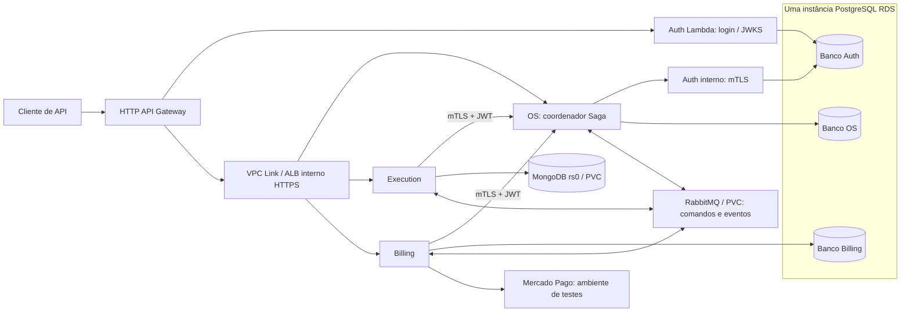

# CI/CD final — homolog e demo-a

Revisão de 11/11/2026. Este documento substitui as instruções operacionais
baseadas em seleção manual de fases. O código mantém checkpoints internos.

## Estado da entrega

A refatoração local oferece três entradas: **Plan → Deploy → Destroy**.
Os testes offline aprovados não são evidência de funcionamento na AWS.
Nenhum workflow conectado ou operação AWS foi executado nesta revisão.

**Ainda não é correto declarar todos os critérios de aceitação concluídos:**

- Os quatro CIs inspecionados têm gates de testes, cobertura e verificações de
  segurança/runtime, mas não demonstram SonarQube/CodeQL/PMD/SpotBugs nas revisões
  auditadas. Auth declara SonarQube pendente. O Plan bloqueia ausência de análise
  estática aprovada para o mesmo SHA; cobertura não substitui esse requisito.
- Deploy e Destroy têm um único job operacional protegido cada. A manutenção IAM
  revisada pelo Plan acrescenta delegação OIDC exata: o Environment bootstrap pode
  assumir provision/deploy; destroy pode assumir provision para o teardown.
  Os subjects imutáveis originais são preservados e destroy não assume bootstrap.
  Essa mudança de trust ainda não foi aplicada na AWS. A aprovação permanece a
  aprovação nativa do job no Environment existente, conforme
  [Reviewing deployments](https://docs.github.com/en/actions/how-tos/deploy/configure-and-manage-deployments/review-deployments).
- A identidade pública de assinatura JWT permanece uma entrada persistente
  externa. A role deploy continua proibida de ler/criar `auth-signing`. Não existe
  um provisionador autorizado dessa identidade nos executores atuais. O Plan exige
  seu ARN exato e verifica metadados; login/JWKS validam sua utilização depois.
- Conta FREE, créditos, quotas, capacidade, credenciais externas, CI remoto atual,
  aplicação AWS, pagamento e telemetria não foram validados ao vivo nesta revisão.

Esses pontos não são convertidos em PASS. O relatório do Plan diferencia
BLOCKED/FAIL de verificações DEFERRED dependentes do Deploy.

## Cinco repositórios efetivamente inspecionados

Foram clonados checkouts limpos diretamente de `homolog` em `review-sources/`,
ignorados pelo Git. Os checkouts irmãos com alterações locais foram preservados.

| Repositório | Revisão homolog observada |
|---|---|
| k8s-infra, antes da refatoração | `214bf8fd68495a2e7f9ce944face7095fdafb3e6` |
| auth | `6177535915d7f37bf42496e0c423b6af523bbfef` |
| os-service | `2aea68cf404541d59847e360914c82ac9bfc7730` |
| execution-service | `c873ff47b36765d7b2942953de3e15d3bbf075de` |
| billing-service | `412029ea97a75a6884216150b5c71fae84389df1` |

`phase4/environments/demo-a.sources.json` fixa as quatro revisões. O Plan consulta
o HEAD remoto e checks da revisão exata. HEAD diferente exige revisão do lock;
um CI antigo ou um rerun mais recente com falha não autoriza a revisão atual.
A consulta de runs pelo conector não trouxe evidência utilizável de CI aprovado;
não se declarou que os CIs remotos passaram.

Foram lidos fontes produtivos, aplicações Spring/configuração do Auth, Dockerfiles,
POMs, verificadores dos CIs, migrations, controllers REST, adapters de pagamento,
componentes de segurança, runner/feature `integration/9.1.4`, runner/Compose
`integration/8.3.5`, Terraform, scripts de publicação, secrets, recovery e teardown.

## Arquitetura mínima real

- VPC em us-east-1, EKS, dois nodes `m7i-flex.large` e ECRs imutáveis.
- Uma instância PostgreSQL RDS `db.t4g.micro`, 20 GiB, com bancos e usuários
  separados para Auth, OS e Billing. Não são três instâncias RDS.
- Execution usa MongoDB com replica set `rs0`, uma réplica e PVC gp3 de 5 GiB.
  Replica set habilita transações; uma réplica não oferece alta disponibilidade.
- RabbitMQ mantém exchanges `oficina.commands`/`oficina.events`, vhost `/oficina`,
  usuários por serviço, filas/DLQs e PVC gp3 de 5 GiB.
- OS coordena a Saga. Outbox/Inbox persistentes sustentam publicação, consumo,
  retentativa e deduplicação nos serviços. Rejeição de orçamento compensa a Saga;
  falha após trabalho físico pode exigir intervenção manual, conforme a suíte.
- Auth público é Lambda Java 21 atrás de HTTP API, emitindo JWT e publicando JWKS.
  Auth interno é um workload separado no EKS, sem chave privada de assinatura.
- API Gateway expõe rotas permitidas e integra os serviços via VPC Link/ALB interno
  HTTPS. REST interno OS→Auth, Execution→OS e Billing→OS utiliza TLS/mTLS e JWT.
- OS/Execution/Billing são aplicações Java 21/Spring; todos os Dockerfiles são
  multistage e usam usuário não root. As bases produtivas de Execution/Billing
  observadas ainda usam tags; publicação resolve imagens e registra digests ECR.
- Billing tem adapter HTTP Mercado Pago produtivo, checkout/reconciliação e
  validação de assinatura. O provedor administrativo da suíte Docker é simulado
  e não é implantado pelo adapter AWS.
- CloudWatch cobre logs de EKS/Lambda/HTTP API. New Relic reaproveita `nri-bundle`.
  Variáveis de tracing não comprovam que um agente APM Java foi empacotado:
  não há alegação de tracing APM distribuído validado nesta revisão.

Os serviços não acessam bancos de outros serviços. O seed de dados fictícios é
ferramenta administrativa de teste em demo-a, fora do runtime dos microsserviços.
Não foram adicionados frontend, banco RDS adicional, serviço de negócio ou dashboard.

O diagrama descreve o alvo do Deploy; não é evidência de conectividade já testada.

## Confronto com o documento FIAP

Foi lido o PDF local `12SOAT - Fase 4 - Tech challenge.pdf`. Ele exige pelo menos
três microsserviços, bancos próprios SQL/NoSQL, isolamento de dados, mensageria,
Saga com compensação, testes unitários, um fluxo BDD completo, cobertura mínima
de 80% por serviço, análise de qualidade no CI, Kubernetes, pipelines independentes,
proteção de main e observabilidade da fase anterior.

OS, Execution e Billing satisfazem a divisão sugerida; Auth é adicional necessário
para o cenário de autenticação. Bancos lógicos distintos na mesma instância RDS
preservam isolamento por credenciais sem multiplicar instâncias.

As suítes/POMs incluem JaCoCo 80%; o Plan verifica o gate e o CI do mesmo SHA.
Análise estática e proteção remota de main não foram comprovadas nesta revisão.
O vídeo tem limite de 15 minutos; o PDF final deve incluir participantes, links,
diagrama, estratégia Saga e justificativas arquiteturais.

## Fluxo exato do Plan

1. Checkout do commit da dispatch homolog, ferramentas fixadas, empacotamento local
   de recovery e OIDC por roles existentes.
2. Job bootstrap lê o state persistente de identidades, preserva inventário,
   prepara manutenção/fundação de artefatos/recovery e gera um **plano Terraform
   binário real**, sem apply.
3. Job provision executa preflight AWS somente leitura, valida configuração,
   assinatura externa, revisões/checks atuais, Dockerfiles e gate JaCoCo, e gera
   o **plano Terraform binário real de Infra**.
   As imagens de dados/probe por digest são baixadas no runner e inspecionadas:
   digest e plataforma Linux/amd64 precisam coincidir. Não são recursos AWS novos.
4. Job runtime valida as entradas externas quando as permissões já existem.
   AccessDenied por uma concessão ainda planejada é registrado como DEFERRED,
   nunca como leitura validada. ARN inválido, credencial inválida ou recurso
   comprovadamente ausente falha.
5. Consolidação inclui todas as verificações. Falha ou BLOCKED impede publicar
   bundle aprovado. Platform/Edge dependentes de outputs futuros são descritos
   como dependências, não como planos Terraform definitivos.
6. `bundle.json` reúne manifesto, planos cifrados com AES-GCM, revisões, conta,
   região, configuração, states, limites de recursos/custo e ordem dos checkpoints.
   SHA256 vincula manifesto e conteúdo cifrado. Validade operacional: artifact
   retido por sete dias e contexto/state ainda coincidentes.

PASS permite iniciar o Deploy; não atesta que a aplicação já está funcionando.
O Plan não cria infraestrutura de aplicação nem executa apply.

## Fluxo exato do Deploy

Uma dispatch recebe somente `plan_run` e `approved_plan_sha256`.
O executor valida origem, workflow, conclusão, branch, commit, conta, região,
configuração e autenticação dos artifacts. Environments continuam sendo a
autorização real; inputs de aprovação ou timestamps não são fabricados.

Sequência interna definida em `complete.py`, executada em um único job aprovado
no Environment bootstrap, renovando credenciais OIDC por role entre blocos:

1. Aplicar o binário revisado de identidades/fundação persistente.
2. Aplicar o binário revisado de Infra; preservar bootstrap-admin desabilitado.
3. Atualizar inventário IAM; comprovar canário independente fechado, ativar recovery
   e provar fechamento por expiração de lease.
4. Publicar quatro imagens, JAR Auth e layer; verificar readback/digests/versões.
5. Gerar/aplicar Platform inicial; atualizar inventário IAM das novas identidades.
6. Preparar foundation/RBAC/StorageClass, validar rede e instalar controller.
7. Validar identidade pública externa; gerar/projetar secrets e PKI técnicos;
   preparar MongoDB/RabbitMQ e bancos PostgreSQL.
8. Gerar/aplicar perfil de migração e executar/verificar migrations/grants.
9. Preparar Auth/Edge; atualizar IAM; verificar JWKS real.
10. Gerar/aplicar perfil de aplicações; implantar Auth interno e três serviços;
    aguardar rollouts/probes reais.
11. Preparar ALB/identidades, atualizar controller/Ingress, verificar listener/targets.
12. Consultar vendedor de teste Mercado Pago; só então publicar negócio e webhook.
    Esse recibo comprova configuração de teste, não uma transação financeira.
13. Instalar observabilidade. Com `apiKey`/`accountId` no secret New Relic, consultar
    ingestão real; apenas `licenseKey` deixa a confirmação de ingestão DEFERRED.
14. Executar health, seed fictício, E2E/BDD e compensação; consolidar evidências.

Planos posteriores são gerados depois das dependências. Antes de aplicar o
binário gerado, o executor rejeita delete/replacement, tipos fora do escopo,
novos EKS/EC2/RDS, expansão de contagens, Lambda fora dos limites de memória/
concorrência e logs sem retenção limitada. Alterações rejeitadas exigem revisão;
não há um botão que as libere silenciosamente.

Cada bloco grava receipt interno AES-GCM vinculado ao plano, commit e run de Deploy.
States e inventário devem coincidir com o receipt anterior. **Retomada parcial
que alterou state exige novo Plan**, preservando recursos e artefatos existentes;
a implementação não garante retomar automaticamente o mesmo bloco após apply
parcial. Não se remove lock ativo nem se executa Destroy por falha do Deploy.

## E2E/BDD AWS e pagamento

`aws_e2e.py` reutiliza os helpers HTTP/login/polling e a asserção `bdd_then` do
Billing `integration/9.1.4`. Confere a feature original antes de executar.
Não importa os globals Docker/fixtures nem o endpoint administrativo do mock.

`demo_fixture.py` usa Jobs PostgreSQL com TLS e credenciais por banco para criar
usuários fictícios, hashes Argon2id compatíveis com Auth, filial/grants restritos,
vínculo cliente/identidade e atribuição do mecânico. A aplicação cria cliente,
veículo e OS por HTTP. O seed não altera identidades preexistentes de terceiros.
O SQL temporário passa por Secret Kubernetes com ownership; nunca por Terraform,
artifact, linha de comando ou log público. Não há acesso pods/exec adicional.

O fluxo faz login, rejeita acesso anônimo/papel incorreto, inicia/conclui diagnóstico,
aguarda orçamento/notificação, aprova financeiramente, inicia/conclui reparo,
solicita checkout e aguarda confirmação real. Só após consultar `CONFIRMED`,
`FINALIZADA` e `COMPLETED` publica BDD aprovado. Depois rejeita outro orçamento e
exige OS `CANCELADA`, Saga `COMPENSATED` e ausência de pagamentos.

**O pagamento não é inventado nem automaticamente aprovado.** Após criar checkout,
o operador consulta a URL com login do cliente no endpoint indicado pelo log e
conclui o pagamento na interface sandbox do Mercado Pago. O executor espera até
15 minutos e falha com diagnóstico se a confirmação não chegar. Sem credenciais
e vendedor/comprador de teste corretos, esse trecho permanece bloqueado.

O adapter não substitui todos os casos distribuídos Docker: indisponibilidade
forçada do broker, reentrega/DLQ e falha de reparo físico continuam na suíte local.
O registro da OS no journal é idempotente depois de recebido o ID; perda da resposta
antes desse registro ainda pode exigir reconciliação manual da OS criada.

## Fluxo exato do Destroy

Uma dispatch exige `DESTROY demo-a` e uma aprovação no Environment destroy.
O job assume provision via OIDC, recupera inventário/state, bloqueia API/Ingress, remove aplicações,
PVCs/volumes pertencentes ao ambiente, espera ALB/targets, remove Helm e objetos
de cluster com ownership e revoga acesso temporário/fecha o endpoint.

No mesmo job, o executor assume a role destroy, verifica receipt/geração do cluster ou ausência
comprovada de workloads numa criação parcial, destrói Edge → Platform → artefatos/
secrets efêmeros → Infra e verifica resíduos. Teardown falho não concede permissão
para ignorar workloads remanescentes. Diagnóstico final é publicado mesmo em falha.

Preservados explicitamente: backend/state, identidades OIDC/boundaries, infraestrutura
persistente de recovery, bucket de artefatos (objetos efêmeros inventariados são
removidos), assinatura pública persistente e entradas externas sob `/inputs/`.
Não se remove recurso apenas por prefixo. Ausência de recursos observáveis não
comprova fechamento imediato da fatura: há atraso de medição/cobrança.

## Configuração externa que ainda impede a primeira implantação

Preparação única, em variáveis/secrets existentes; não há formulário de fases:

- `PLAN_ARTIFACT_KEY`: secret de repositório compartilhado pelos jobs, base64 de
  32 bytes; `SOURCE_READ_TOKEN` se necessário para os repositórios de serviços.
- `NETWORK_PROBE_IMAGE`, `MONGODB_IMAGE`, `RABBITMQ_IMAGE`, `POSTGRES_IMAGE`:
  referências reais por digest; três versões de addons compatíveis com EKS.
- `ALB_CERTIFICATE_ARN` e `ALB_SERVER_NAME`: certificado/região/nome reais.
- `AUTH_SIGNING_SECRET_ARN`: ARN canônico `/oficina/phase4/demo-a/auth-signing`,
  tags `EnvironmentId=demo-a` e `Lifecycle=persistent`, documento de chaves válido
  no formato `KeyDocuments` do Auth. Seu proprietário é responsável pela rotação.
- `RECOVERY_ALARM_TOPIC_ARN`: SNS existente para alarmes independentes.
- `MERCADO_PAGO_TEST_SECRET_ARN`: entrada `/inputs/mercado-pago`, campos
  `access-token` TEST e `webhook-secret`; URLs HTTPS reais de retorno nas variáveis
  `MERCADO_PAGO_SUCCESS_URL`, `MERCADO_PAGO_FAILURE_URL`, `MERCADO_PAGO_PENDING_URL`.
  O notification URL deriva da HTTP API e o webhook é publicado internamente.
- `NEW_RELIC_SECRET_ARN`: entrada `/inputs/newrelic`, `licenseKey`; `apiKey` e
  `accountId` numérico são necessários para confirmar dados recebidos por API.
- `E2E_FIXTURE_SECRET_ARN`: entrada `/inputs/e2e-fixture`. JSON com
  `environment=demo-a`, `payment_mode=mercado-pago-test`, `customerDocument` fictício
  válido, `vehiclePlate` fictícia e `users` contendo exatamente `atendente`,
  `gerente`, `mecanico`, `clienteB`. Cada usuário tem email minúsculo em
  `@example.invalid` e senha gerada de 12–1024 caracteres. Não exige OS/usuários
  preexistentes nem timestamps de autorização.
- CI e análise estática aprovada nos SHAs fixados; proteção de main e reviewers
  existentes; backend/roles/bootstrap efetivamente instalados; evidência real da
  conta FREE/quotas/créditos. A elegibilidade não é inferida de uma aprovação.

## Custos e riscos

Não se presume gratuidade de EKS/RDS/EC2. O preço público do control plane EKS
em suporte padrão é US$ 0,10/h, antes de nodes e demais recursos:
[preços oficiais EKS](https://aws.amazon.com/eks/pricing/).
Suporte estendido é mais caro; não foi autorizado upgrade do plano da conta.

Somam-se dois nodes, discos root, RDS/armazenamento, PVCs gp3, IPv4 públicos,
ALB/LCUs, endpoints VPC, tráfego, ECR/S3, logs, Lambda, Secrets Manager e eventual
ingestão New Relic. Recovery/identidades/inputs persistentes podem ter custo após
Destroy. Créditos, validade e custos reais da conta não foram consultados.
O relatório enumera recursos possivelmente cobrados; nenhuma estimativa substitui
Cost Explorer/fatura. Não há ambiente demo-b ou stack de observabilidade adicional.

## Validação offline e demonstração

Resultados e comandos estão em `docs/cicd-final-validation.md`.
São evidências offline, não aprovação de deploy AWS.

Roteiro sugerido de até 15 minutos, somente após resolver os bloqueios:

1. 0–2 min: arquitetura e separação de bancos/Saga.
2. 2–4 min: revisão/hash do Plan e checks dos SHAs.
3. 4–6 min: execução real do Deploy e seus checkpoints automáticos.
4. 6–10 min: login, OS, diagnóstico, orçamento, reparo e checkout de teste real.
5. 10–12 min: estados finais e orçamento rejeitado/compensação.
6. 12–14 min: pods, logs correlacionáveis e métricas efetivamente recebidas.
7. 14–15 min: Destroy autorizado e relatório de resíduos/preservados.

Use gravações das execuções reais se os workflows demorarem mais que o vídeo.
Não mostre senhas, JWT, chaves, secrets, kubeconfig ou payloads privados.
